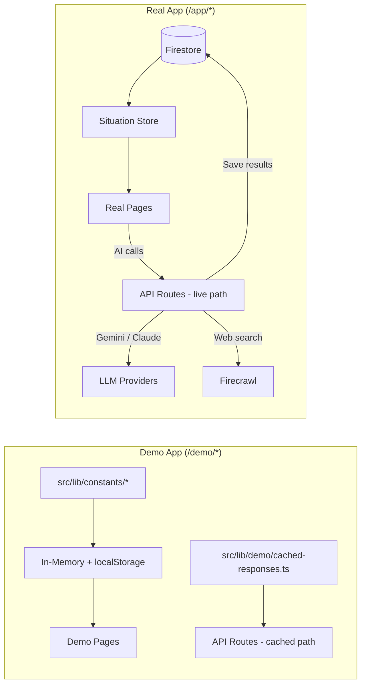

# PRAXIS — Dual-App Architecture

> Canonical reference for the demo/production split. Updated as the codebase evolves.

## Route Architecture

```
/                         → Landing page (public)
/login                    → Unified login page (public)
/demo/dashboard           → Demo app entry (cookie auth)
/demo/assistant           → Demo AI chat (cached)
/demo/[any-tool]          → Demo tool pages (pre-loaded data)
/app/dashboard            → Real PRAXIS entry (Firebase auth)
/app/assistant            → Real AI chat (live, situation-bound)
/app/[any-tool]           → Real tool pages (situation-bound Firestore data)
/api/*                    → API routes (auth-protected)
/privacy, /terms          → Static pages (public)
```

## Login Flow

```mermaid
flowchart TD
    LP[Landing Page] -->|"Sign In / Create Account"| LOGIN[/login]
    LP -->|"Try Demo / Explore Demo"| DEMO_LOGIN["/login?mode=demo"]

    LOGIN -->|Firebase Google or Email auth| APP[/app/dashboard]
    DEMO_LOGIN -->|Sets demo cookie| DEMO[/demo/dashboard]

    APP -->|No situations| WIZARD[Situation Creation Wizard]
    WIZARD -->|Created| DASH[/app/dashboard with active situation]

    DEMO -->|"Exit Demo"| LP
    DEMO -->|"Get Full Access"| LOGIN
```

## Situation-Driven Data Model (Real App Only)

Every piece of data in PRAXIS belongs to a situation:

```
Firestore:
  users/{uid}/
    profile (credits, settings, subscription)
    situations/{situationId}/
      metadata (name, type, region, description, actors, status)
      conflict-grammar (extracted ACO entities)
      graph (nodes + edges)
      documents/{docId} (uploaded files + extraction results)
      reports/{reportId} (generated reports)
      scenarios/{scenarioId} (what-if analyses)
      chats/{chatId} (conversation history)
      briefings/{briefId}
      dossiers/{dossierId}
      talking-points/{tpId}
      risk-assessments/{raId}
      timeline-events/{eventId}
      stakeholder-map
      negotiation-preps/{prepId}
      media-analyses/{maId}
      treaty-analyses/{taId}
      sanctions-scans/{scanId}
```

## Data Flow



## Shared vs Separate Code

### Shared (both apps use)
- `src/components/ui/*` — Radix primitives
- `src/components/shared/*` — Display components
- `src/lib/ai/*` — Provider config, prompts, schemas, tools
- `src/lib/firebase/*` — Config, admin, Firestore helpers
- `src/lib/utils/*` — Formatting, cn, date helpers
- `src/types/*` — TypeScript types

### Demo-only
- `src/app/demo/*` — Demo path segment
- `src/components/demo/*` — Demo shell, sidebar, header
- `src/lib/demo/*` — Cached responses, demo data provider
- `src/lib/constants/*` — All demo case data (Nordalia, etc.)

### Real-app-only
- `src/app/app/*` — Production path segment
- `src/components/praxis/*` — Real app shell, sidebar, header
- `src/lib/services/*` — Firestore CRUD, AI pipelines
- `src/stores/situation-store.ts` — Active situation state

## Auth Matrix

| Route       | Auth Required       | Data Source         | Credits   |
|-------------|---------------------|---------------------|-----------|
| `/demo/*`   | Demo cookie only    | In-memory constants | Unlimited |
| `/app/*`    | Firebase JWT        | Firestore           | Deducted  |
| `/api/*`    | withAuth() wrapper  | Per-route           | Per-route |
| `/`, etc.   | None (public)       | Static              | N/A       |

## Middleware Rules

```
/demo/*  → Require demo session cookie → else redirect /login?mode=demo
/app/*   → Require Firebase JWT cookie → else redirect /login
           If demo cookie → redirect /demo/dashboard
/api/*   → Handled by withAuth() per route handler
/*       → Public
```
