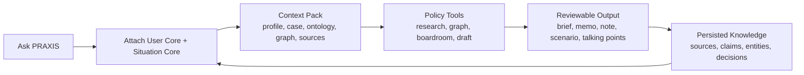
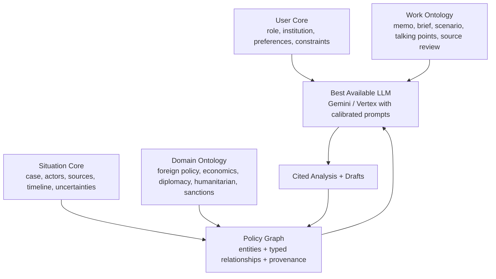
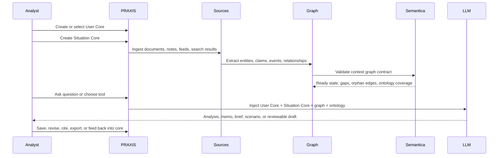
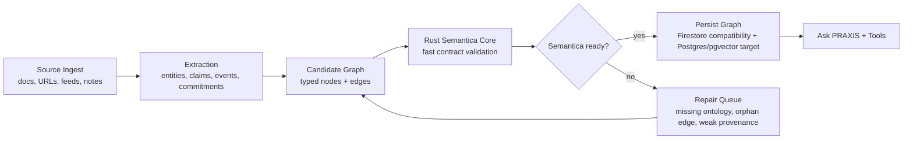

# PRAXIS by TACITUS

> **The context layer and workbench that helps policy teams use AI seriously.**
>
> v6.4.x · GCP Cloud Run · Next.js 16 frontend/API gateway · Python FastAPI graph backend · Rust Semantica core · Firebase/Firestore · Project `praxisbytacitus` · Region `us-central1` · Domain `praxis.tacitus.me`

PRAXIS exists because policy analysis teams cannot get professional results by dropping sensitive, ambiguous, multi-source situations into a blank chat box. A useful model needs to know **who is asking**, **what situation it is inside**, **which ontology should organize the facts**, **which sources are trusted**, and **what kind of work product is needed**.

PRAXIS builds and manages that context. It gives each workspace a **User Core** for the team or analyst, one or more **Situation Cores** for live cases, a typed **policy graph**, domain-targeted ontologies, source receipts, suggested tools, and drafting workflows. Those cores are injected into calibrated LLM calls so the AI can reason, retrieve, compare, challenge, and draft with the right institutional memory instead of generic instructions.

The product target is deliberately simple:



The public app and authenticated workbench are organized around that loop. PRAXIS is not a loose catalogue of AI tools; it is a context-building system for foreign policy, economic policy, diplomacy, humanitarian, legal, sanctions, conflict, and political analysis teams.

This README is a **reference document for both human developers and AI agents** (Claude Code + Codex). For agent-specific conventions, model-string discipline, security boundaries, and anti-patterns, see [`CLAUDE.md`](./CLAUDE.md) (Codex agents: see [`AGENTS.md`](./AGENTS.md)).

---

## Current Ship Checkpoint

As of 2026-05-11, `main` is aligned around a simplified PRAXIS MVP:

- **Public landing page:** PRAXIS is positioned as the context layer for policy AI.
- **Authenticated app:** Ask PRAXIS is the primary entry point, with a repository spine for User Cores, Situation Cores, graph/sources, tools, and memo output.
- **Rust Semantica core:** `rust/semantica-core` validates the minimal context-graph contract and is deployed inside the Cloud Run frontend image.
- **Policy workbench:** the exposed app surface is intentionally narrow: Home / Ask, Library, Cores, Tools, Drafts, Settings/Admin, and a gated archive for legacy specialist tools.

The operating packet is [`docs/v7/README.md`](./docs/v7/README.md), with current status in [`docs/v7/STATUS.md`](./docs/v7/STATUS.md) and open decisions in [`docs/v7/OPEN_QUESTIONS.md`](./docs/v7/OPEN_QUESTIONS.md). The active strategic plans for this wave are [`docs/roadmap/PRAXIS_DESIGN_LED_AGENTIC_APP_PLAN_2026-05-08.md`](./docs/roadmap/PRAXIS_DESIGN_LED_AGENTIC_APP_PLAN_2026-05-08.md), [`docs/roadmap/PRAXIS_AGENTIC_MOBILE_FIRST_UX_PLAN_2026-05-08.md`](./docs/roadmap/PRAXIS_AGENTIC_MOBILE_FIRST_UX_PLAN_2026-05-08.md), and [`docs/roadmap/PRAXIS_TACIT_KNOWLEDGE_UX_REORGANIZATION_PLAN_2026-05-08.md`](./docs/roadmap/PRAXIS_TACIT_KNOWLEDGE_UX_REORGANIZATION_PLAN_2026-05-08.md).

The full-repo graphify map is larger than the HTML visualization guard, so use
`graphify-out/GRAPH_REPORT.md` and `graphify-out/graph.json` for architecture
navigation.

---

## Table of Contents

1. [Product Model](#product-model)
2. [Core Context Model](#core-context-model)
3. [Semantica and the Graph](#semantica-and-the-graph)
4. [Policy Team Workflows](#policy-team-workflows)
5. [Architecture](#architecture)
6. [Tech Stack](#tech-stack)
7. [File Map](#file-map)
8. [Two Experiences: Demo vs Real App](#two-experiences-demo-vs-real-app)
9. [Quick Start (Local Development)](#quick-start-local-development)
10. [Environment Variables](#environment-variables)
11. [Scripts](#scripts)
12. [Deployment (Cloud Run)](#deployment-cloud-run)
13. [Verification Before Deploy](#verification-before-deploy)
14. [Tools, Frameworks, Data Feeds](#tools-frameworks-data-feeds)
15. [Calibration Contract (AnalystProfile)](#calibration-contract-analystprofile)
16. [What's Next](#whats-next)
17. [Documentation Map](#documentation-map)
18. [Working With Agents](#working-with-agents)

---

## Product Model

PRAXIS is a professional workbench for policy teams that need AI to produce reliable analysis, not generic prose. The application creates a reusable operating model around every analyst and every case.

| Layer | What it answers | Why it matters |
|---|---|---|
| **User Core** | Who is asking? What institution, role, methods, risk posture, writing style, constraints, and recurring needs shape the answer? | Prevents the model from treating a diplomat, sanctions analyst, humanitarian coordinator, and economic-policy team as the same user. |
| **Situation Core** | What case is the team working on? Which actors, claims, events, sources, commitments, risks, uncertainties, and decisions define it? | Gives every analysis a grounded case model instead of forcing the user to repeat context in every prompt. |
| **Domain Ontology** | Which policy domain should organize the work: diplomacy, economic sanctions, conflict, humanitarian response, governance, cyber, climate security, and more? | Makes extraction, retrieval, tool selection, and drafting match the team's professional vocabulary. |
| **Work Ontology** | What kind of work is being produced: memo, briefing, scenario, negotiation note, stakeholder map, early warning, source review, or talking points? | Shapes output structure, evidence standard, caveats, and review flow. |
| **Policy Graph** | How do actors, claims, interests, events, risks, constraints, leverage, and commitments relate? | Turns a pile of documents into inspectable structure that can be queried, challenged, and reused. |
| **Drafting Layer** | What should be written, for whom, with which level of confidence and citation? | Converts context and graph-backed analysis into professional work products. |

The app is built so teams can create, inspect, attach, detach, update, and reuse these cores. Ask PRAXIS is central because the user can start with a question, but the system routes that question through the right context and tools.



## Core Context Model

### User Core

The User Core is the durable model of the analyst, team, or organization. It is created through onboarding and profile maintenance, then injected into AI routes through the calibration layer.

It captures:

- role and organization context;
- policy domains and recurring jurisdictions;
- methodological preferences and analytical frameworks;
- tone, format, and writing expectations;
- risk tolerance, confidence thresholds, and caveat discipline;
- preferred sources, restricted sources, and institutional constraints;
- saved outputs and feedback signals that should improve future work.

In code, the User Core is represented by the `AnalystProfile` contract and consumed by calibrated AI routes through `withCalibration(...)`, `buildCalibratedContext(...)`, and the system-prompt context builders under `src/lib/context/` and `src/lib/ai/`.

### Situation Core

The Situation Core is the case model. It is where PRAXIS turns a policy problem into a structured operating picture.

It captures:

- case frame, geography, timeframe, and policy objective;
- actors, institutions, coalitions, interests, constraints, and leverage;
- claims, narratives, risks, commitments, events, and uncertainties;
- source library, source receipts, conflicting evidence, and provenance;
- selected domain ontology and work ontology;
- graph state, extraction runs, tool outputs, and review decisions.

Situation Cores are designed to be inspectable. A team should be able to see what the system believes, where it came from, what is uncertain, and what changed after a new source, analyst note, or tool run.

### Core Lifecycle



## Semantica and the Graph

PRAXIS uses Semantica as the semantic contract for context-core creation. The current deployed Rust component is intentionally small and strict: it validates that a context graph has a root context core, a domain ontology, a work ontology, bounded node/edge counts, unique node IDs, and no orphan relationships.

That validator lives in [`rust/semantica-core`](./rust/semantica-core) and is invoked from [`src/lib/semantica/rust-runtime.ts`](./src/lib/semantica/rust-runtime.ts). The deployed health endpoint is `/api/health/semantica-core`.



The near-term roadmap is to expand Semantica from a minimal validator into the durable context compiler:

- validate richer ontology coverage for domain-specific cases;
- score source and relationship quality before a graph is trusted;
- compile context packs for LLM prompts and agent workflows;
- expose graph gaps and repair suggestions in the UI;
- support fast Rust-side transforms for larger policy graphs at scale.

The graph layer is built around the ACO conflict and policy ontology: Actor, Claim, Interest, Constraint, Leverage, Commitment, Event, Narrative, Institution, Norm, Resource, Risk, Policy, and Grievance. These primitives let PRAXIS move beyond summaries into reusable structure.

## Policy Team Workflows

PRAXIS is designed for teams that need context-aware AI across repeatable workflows.

| Team | Core need | PRAXIS workflow |
|---|---|---|
| Foreign policy desk | Understand actors, options, constraints, and second-order effects. | Build a Situation Core, run graph-grounded research, compare narratives, draft an options memo. |
| Economic policy team | Track shocks, sanctions, tradeoffs, and macro-political effects. | Attach economic ontology, ingest indicators and source evidence, draft decision notes and risk scenarios. |
| International diplomacy team | Prepare for meetings, negotiations, communiques, and partner alignment. | Map stakeholders and commitments, monitor changes, draft talking points and negotiation briefs. |
| Humanitarian or conflict team | Understand needs, access constraints, violence trends, and operational risks. | Combine open feeds with situation graph, inspect evidence, produce cited situation updates. |
| Legal, sanctions, or governance team | Maintain defensible evidence and policy reasoning. | Preserve source receipts, trace claims, draft structured analysis with confidence and caveats. |

The consolidated app surfaces map to this work:

- **Ask PRAXIS:** the primary command surface for questions, tool suggestions, and context-aware follow-up.
- **Library / Repository:** User Cores, Situation Cores, sources, graph objects, tools, and work products in one place.
- **Context Studio:** create, inspect, and repair cores.
- **Research:** source search, deep research, feed ingestion, and evidence review.
- **Graph:** actor maps, relationships, commitments, narratives, timelines, and provenance.
- **Boardroom:** scenarios, alternative hypotheses, mediation/negotiation views, and advisory workflows.
- **Draft:** policy memos, briefings, talking points, dossiers, reports, and exports.

## Architecture

```
┌─────────────────────────────────────────────────────────────────┐
│  Frontend/API Gateway (Next.js 16) → Cloud Run praxis-frontend  │
│    src/app/app/*       Ask PRAXIS + repository/workbench shell   │
│    src/app/demo/*      Demo mirror pages (cookie auth)          │
│    src/app/onboarding  3-screen wizard                          │
│    src/app/api/*       calibrated routes for AI, data, auth      │
├─────────────────────────────────────────────────────────────────┤
│  Rust Semantica Core → packaged in the frontend container        │
│    rust/semantica-core  fast context-graph contract validation   │
│    /api/health/semantica-core  deployed readiness proof          │
├─────────────────────────────────────────────────────────────────┤
│  Backend (Python FastAPI) → Cloud Run praxis-backend (private)  │
│    /api/v1/pipeline/*   extract → build → cluster → analyze     │
│    /api/v1/graph/*      graph queries, temporal                 │
│    /api/v1/analyze/*    pre-computed analysis                   │
│    /api/v1/memory/*     disabled-safe Cognee memory bridge      │
├─────────────────────────────────────────────────────────────────┤
│  Firebase: Auth + Firestore user/session/situation metadata     │
│  GCP:  Vertex AI · BigQuery · Cloud Storage · Pub/Sub           │
│        Cloud Functions · Cloud Scheduler · Secret Manager       │
│        Artifact Registry · Cloud Build                          │
│  Target graph store: Postgres + pgvector, with Firestore paths   │
│  Optional: private praxis-cognee service + praxis_cognee DB      │
└─────────────────────────────────────────────────────────────────┘
```

**Backend invocation:** The Python backend is private Cloud Run
(`--no-allow-unauthenticated`). Browser-facing Next.js API routes call it
server-side with Cloud Run OIDC via `src/lib/api/praxis-backend-server.ts`.
The backend verifies the OIDC token audience and an allowlist of trusted
service-account emails before accepting service-to-service calls. End-user
identity is forwarded separately through `X-Firebase-Token` or, for trusted
internal workers only, `X-PRAXIS-UID`.

### Graphify ACO Pipeline (Backend)

```
extract → build → cluster → analyze → report → export
```

1. **extract.py** — Gemini reads source text → structured ACO nodes + edges
2. **build.py** — Merges extractions into a NetworkX multigraph
3. **cluster.py** — Leiden community detection (graspologic) → faction assignments
4. **analyze.py** — Pivot actors (centrality), hidden linkages, Glasl escalation, ZOPA
5. **report.py** — Markdown brief + structured JSON output
6. **export.py** — Firestore sync and optional graph export adapters

### ACO v2.0 — Agentic Conflict Ontology

**14 entity types** (8 core + 6 extended): Actor · Claim · Interest · Constraint · Leverage · Commitment · Event · Narrative · Institution · Norm · Resource · Risk · Policy · Grievance.

**72 typed relationships** in 5 categories (causal, structural, antagonistic, cooperative, foundational). See `backend/graphify_tacitus/schemas/relationships.py`.

**Confidence levels:** EXTRACTED · INFERRED · AMBIGUOUS · ASSESSED.

Graph writes store `corePrimitiveCoverage`, a compact Core-8 report that
counts Actor, Claim, Interest, Constraint, Leverage, Commitment, Event, and
Narrative nodes and lists missing primitives. This makes ontology gaps visible
before an analyst trusts a graph-backed assessment.

### Executive Situation Intelligence

The real dashboard includes an on-demand executive intelligence panel backed by
`POST /api/ai/situation-intelligence`. The route uses the existing calibrated
AI path and validates structured output for diagnosis, strategic insight,
causal timeline, actor dossiers, scenarios, derived risk score, concrete
actions, graph primitives, provenance, confidence, persisted memory, and JSON
export. Shared schema: `src/lib/ai/schemas/situation-intelligence.ts`.

### Graph-Grounded Research Modes

The Syria workspace now documents the intended live research pattern for
PRAXIS tools:

```
Search -> Extract -> Validate -> Stage -> Reason -> Draft
```

Searches produce source receipts and typed graph candidates, not only prose.
GraphOps stages candidate updates with provenance before they become durable
memory. Downstream tools then retrieve by graph path, ontology track, source
confidence, and discrepancy state so memos and briefings can explain their
evidence basis.

The current modeled research modes are latest-source sweep, think-tank
discrepancy review, commitment/communique monitor, local media divergence,
graph-grounded policy question, and economic/HLP scenario research. See
[`docs/PRAXIS_SYRIA_GRAPH_GROUNDED_RESEARCH_HANDOFF_2026-05-03.md`](./docs/PRAXIS_SYRIA_GRAPH_GROUNDED_RESEARCH_HANDOFF_2026-05-03.md).

---

## Tech Stack

| Layer | Technology |
|---|---|
| Framework | Next.js 16.2.4 (App Router, Turbopack) |
| Language | TypeScript 5.9 (strict), Python 3.11, Rust 2021 |
| UI | React 19, Tailwind CSS 4, Radix UI, Framer Motion 12, D3.js 7, react-leaflet |
| State | Zustand 5 (persisted) |
| AI SDK | Vercel AI SDK v6 (`@ai-sdk/google`, `@ai-sdk/google-vertex`) |
| AI Providers | Gemini Flash / Gemini Pro on Google AI and Vertex AI, Vertex AI Agent Engine (ADK) |
| Backend | Python FastAPI, NetworkX, Graspologic, Pydantic v2, Genkit, disabled-first Cognee adapter |
| Auth & DB | Firebase Auth + Firestore + Admin SDK |
| Semantica | Rust context-graph validator packaged into the frontend Cloud Run image |
| Graph | Postgres + pgvector target for ACO/context graphs, Firestore compatibility paths, optional graph export adapters; Cognee is candidate memory only |
| Validation | Zod 4 |
| Documents | pdf-parse, mammoth, docx, jspdf |
| Web Research | Grounded Google Search and open-data feed clients |
| Payments | Polar |
| Observability | Sentry, OpenTelemetry → Cloud Trace, BigQuery analytics |
| Deployment | GCP Cloud Run (us-central1), Cloud Build CI/CD |

---

## File Map

```
/                            Next.js frontend (root)
├── src/app/
│   ├── app/                 workbench, cases, settings, tools archive, admin
│   ├── demo/                Demo mirror (/demo/*)
│   ├── onboarding/          3-screen wizard
│   ├── (auth)/login/        Sign-in (Google OAuth + email/password + demo)
│   ├── (landing)/           Public marketing pages
│   └── api/                 73 routes
│       ├── ai/              AI tool routes (all use withCalibration unless exempt)
│       ├── auth/            Session, login, logout, test-firebase
│       ├── data/            Intelligence, geospatial, conflicts
│       ├── settings/        api-keys, ai
│       ├── onboarding/      profile GET/PATCH, complete, chips, skip
│       ├── cron/            check-alerts, generate-briefing
│       └── admin/           operator console, account, governance surfaces
├── src/components/
│   ├── ui/                  Radix primitives
│   ├── app/                 AppShell, AppSidebar, Header, DebugPanel, FloatingPRAXIS
│   ├── praxis/              AiPopulate, ToolInfoPanel, NoSituationState, OnboardingRequiredState
│   ├── visualizations/      10 SVG/D3 components (force-graph, risk-gauge, etc.)
│   ├── assistant/           Chat interface, tool invocation
│   ├── reports/             Composer + DOCX/PDF export
│   ├── graph/               D3 conflict knowledge graph
│   └── landing/             Landing sections
├── src/lib/
│   ├── ai/                  providers.ts (single source of model strings), tools.ts (chat tool definitions), prompts/, schemas/, vertex-agent.ts
│   ├── api/                 with-auth, with-credits, with-calibration, save-tool-output, standard-error
│   ├── auth/                auth-context.tsx, cookie-signer.ts (HMAC)
│   ├── firebase/            config.ts, admin.ts, situations-service.ts, analyst-profile-service.ts
│   ├── semantica/           Rust Semantica runtime bridge for context-graph validation
│   ├── context/             profile-context.ts (buildCalibratedContext), system-prompt-block.ts
│   ├── crypto/              envelope.ts (AES-256-GCM for user API keys)
│   ├── data-feeds/          11 source clients + feed-aggregator + capabilities resolver
│   ├── analytics/           risk-engine, escalation-scorer (Glasl), geospatial, trustworthiness
│   ├── knowledge/           Situation Knowledge Core (4 layers: graph, vector, feed, tool-output)
│   ├── domain/              11-domain taxonomy (seeds, classifier, resolve)
│   ├── services/            entity-extraction, canonical-precheck, feedback, graphify-client
│   └── constants/           consolidated tools, tool registry metadata, frameworks, entity colors, lens catalog
├── src/stores/              Zustand: situation, app, conflict, report, debug, notification, preferences
├── src/hooks/               useSituationGuard, usePraxisApi, usePersistedToolData, useKeyboardShortcuts
├── src/types/               Situation v2, AnalystProfile, ConflictGraph, ACO, API
├── src/proxy.ts             Next.js proxy: routing + CSP + COOP + HSTS
│
├── backend/                 Python FastAPI on Cloud Run
│   ├── main.py              FastAPI app entry
│   ├── config.py            Pydantic BaseSettings (single env source)
│   ├── auth.py              Firebase token + OIDC verification
│   ├── routers/             pipeline, graph, analyze
│   ├── services/            firestore_sync, graph_adapter, bigquery, graphiti, gemini
│   ├── ai/                  genkit_app.py, flows.py
│   ├── graphify_tacitus/    ACO pipeline modules (extract, build, cluster, analyze, report, export)
│   └── tests/               pytest
│
├── cloud_functions/
│   ├── on_situation_created/    Auto-trigger pipeline on new situation
│   ├── on_document_uploaded/    Extract text + run pipeline
│   └── gdelt_poller/            Continuous GDELT ingestion worker pool
│
├── rust/
│   └── semantica-core/          Rust validator for the PRAXIS context-core graph contract
│
├── infrastructure/
│   ├── setup-gcp.sh             One-time: enable APIs, BigQuery, Pub/Sub, IAM
│   ├── deploy.sh                Full deploy via Cloud Build (backend → frontend)
│   ├── deploy-backend.sh        Backend only
│   ├── deploy-frontend.sh       Frontend only
│   ├── deploy-windows.ps1       Windows PowerShell deploy
│   ├── bootstrap-user-key-master.sh  Create envelope-encryption master key
│   ├── monitoring-alerts.sh     Cloud Monitoring alert policies
│   └── setup-domain.sh          Custom domain mapping
│
├── scripts/                 audit-ai-routes.mjs, audit-tools.ts, audit-gcp.mjs, verify-tools.ts,
│                            seed-domains.ts, seed-advisors.ts, migrate-user-api-keys.mjs, ...
│
├── tests/                   Vitest unit + Playwright e2e (golden-path, capabilities-api)
│
├── cloudbuild.yaml          CI/CD: build backend → deploy → inject URL → build frontend → deploy
├── docker-compose.yml       Local backend dependencies
├── Dockerfile               Frontend container
├── firestore.rules          Owner-only data isolation
├── firestore.indexes.json   Composite indexes
└── storage.rules            Cloud Storage access control
```

---

## Two Experiences: Demo vs Real App

| | Demo (`/demo/*`) | Real App (`/app/*`) |
|---|---|---|
| **Auth** | Cookie-only `{demo: true}`, no account | Firebase — Google OAuth + email/password |
| **Data** | Pre-loaded Nordalia Crisis | User creates situations; all data in Firestore |
| **AI** | Cached demo responses | Live Gemini / Vertex AI + grounded Google Search |
| **Usage** | Demo capacity | Plan-based workspace limits with internal fair-use controls |
| **Persistence** | In-memory (Zustand + localStorage) | Firestore (user-scoped subcollections) |
| **Purpose** | Investor demos, prospect exploration | Real conflict intelligence work |

Demo sessions are **completely isolated from Firebase** — separate cookie path, never touch production Firestore.

---

## Quick Start (Local Development)

```bash
# Terminal 1 — Next.js frontend (port 3000)
npm install
npm run dev

# Terminal 2 — Backend services (port 8080)
docker-compose up

# Backend health
curl http://localhost:8080/health
```

Open http://localhost:3000. **Demo mode works with zero configuration** — no API keys needed.

For live AI in `/app/*`, copy `.env.example` to `.env.local` and set at minimum `GOOGLE_AI_API_KEY` and `FIREBASE_SERVICE_ACCOUNT_KEY`. The full grouped list is in `.env.local.example`.

---

## Environment Variables

Critical (production):

| Variable | Purpose |
|---|---|
| `FIREBASE_SERVICE_ACCOUNT_KEY` | Admin SDK JSON string (Firestore + token verify) |
| `GOOGLE_AI_API_KEY` | Gemini API (or use Vertex ADC on Cloud Run) |
| `NEXT_PUBLIC_PRAXIS_BACKEND_URL` | Backend Cloud Run URL (auto-set by Cloud Build) |
| `VERTEX_AGENT_ENGINE_ID` | Numeric Reasoning Engine ID for Deep Research Agent |
| `CRON_SECRET` | Cron + admin auth bearer |
| `COOKIE_SIGNING_SECRET` | Session cookie HMAC (primary) — `SESSION_SECRET` is its alias |
| `USER_KEY_MASTER` | 32-byte base64 master key for envelope-encrypted user API keys |
| `ADMIN_ALLOWLIST` | Comma-separated Firebase UIDs that can access `/app/admin/*` |
| `ADMIN_EMAIL_ALLOWLIST` | Comma-separated verified admin emails; defaults to `giulio@tacitus.me` |

Admin access check:

```powershell
npm run admin:check -- giulio@tacitus.me
```

Optional integrations: `POLAR_*`, `RESEND_API_KEY`, `NEXT_PUBLIC_SENTRY_DSN`, graph backend credentials, and operator/monitoring configuration.

Premium research integrations:

| Variable | Purpose |
|---|---|
| `FIRECRAWL_API_KEY` | Premium search/scrape/crawl/map/extract for source acquisition and knowledge-base ingestion |
| `UCDP_API_TOKEN` | Optional UCDP API token sent as `x-ucdp-access-token` for structured conflict records |
| `PARALLEL_API_KEY` | Parallel Search API + MCP for LLM-optimized second-lens research |

Both are optional for free users; PRAXIS falls back to Google/open-source
research paths when they are absent. In production they are stored in Secret
Manager as `praxis-firecrawl-api-key`, `praxis-parallel-api-key`, and
`praxis-ucdp-api-token`.

See `.env.example` and `.env.local.example` for the full grouped reference with placeholders.

---

## Scripts

```bash
# Development
npm run dev                    # Next.js dev server (Turbopack, :3000)
npm run build                  # Production build
npm start                      # Production server
npm run lint                   # ESLint

# Verification
npx tsc --noEmit               # Type check
npm run audit:rust-semantic-core # Rust Semantica tests + build
npm run verify-tools           # Tool registry sanity
npm run audit:tools            # Per-tool calibration scoring (12 dimensions)
npm run audit:routes           # AI route compliance (auth, credits, error handling)
npm run audit:calibration      # Alias of audit:routes
npm run audit:verify           # Confirm latest audit is fresh
npm run audit:gcp              # GCP resource readiness (APIs, secrets, indexes, topics)

# Testing
npx vitest run                                           # Vitest unit
npm run smoke:public                                     # Playwright unauth smoke
npm run smoke:golden-path                                # Full signed-in smoke
cd backend && python -m pytest tests/ -v                 # Backend pytest

# Seeds + migrations
npm run seed:onboarding        # Seed config/onboarding_suggestions
npm run seed:preferences       # Seed default model preferences
npm run seed:advisors          # Seed advisor catalogue (4 flagships)
npx tsx scripts/seed-domains.ts            # Seed 11 domain configs (idempotent)
npm run migrate:user-api-keys  # Encrypt legacy plaintext API keys (--commit to apply)
```

---

## Deployment (Cloud Run)

PRAXIS deploys to **Google Cloud Run** — both services run as containers. **No Vercel.**

```bash
# One-time: enable APIs, BigQuery, Pub/Sub, IAM, Artifact Registry
bash infrastructure/setup-gcp.sh

# Bootstrap envelope-encryption master key (idempotent)
bash infrastructure/bootstrap-user-key-master.sh

# Full deploy (backend first, then frontend with backend URL injected)
bash infrastructure/deploy.sh
# Equivalent:
gcloud builds submit --config=cloudbuild.yaml --project=praxisbytacitus

# Faster frontend-only deploy for UI/tool-page/docs iterations
npm run deploy:frontend:cloud
# Equivalent:
gcloud builds submit --config=cloudbuild.frontend.yaml --project=praxisbytacitus

# Individual services
bash infrastructure/deploy-backend.sh
bash infrastructure/deploy-frontend.sh

# Windows
./infrastructure/deploy-windows.ps1
```

### Custom domain

```bash
gcloud run domain-mappings create --service=praxis-frontend \
  --domain=praxis.tacitus.me --region=us-central1
```

See [`docs/CUSTOM_DOMAIN_SETUP.md`](./docs/CUSTOM_DOMAIN_SETUP.md) for DNS, Firebase Auth authorized domains, and OAuth client setup.

### Build artifacts

- Artifact Registry: `us-central1-docker.pkg.dev/praxisbytacitus/praxis/`
- Frontend service: `praxis-frontend` (public)
- Backend service: `praxis-backend` (`--no-allow-unauthenticated`, OIDC-only)

---

## Verification Before Deploy

**Do not deploy to `praxis.tacitus.me` until all four pass:**

```bash
npx tsc --noEmit                       # 1. TypeScript clean
npm run build                          # 2. Production build clean
node scripts/audit-ai-routes.mjs       # 3. AI routes compliant
npm run audit:rust-semantic-core       # 4. Rust Semantica core valid
npm run audit:gcp                      # 5. GCP resources ready
```

After deploy, verify:

```bash
curl -sI https://praxis.tacitus.me/
curl -sI https://praxis.tacitus.me/login
curl -sI https://praxis.tacitus.me/onboarding
curl -s  https://praxis.tacitus.me/api/health      # status: ok
curl -s  https://praxis.tacitus.me/api/health/semantica-core
```

For 5xx triage, see [`docs/TROUBLESHOOTING.md`](./docs/TROUBLESHOOTING.md).

---

## Tools, Frameworks, Data Feeds

### Consolidated Tool Surface

| Workbench surface | Absorbs |
|---|---|
| **Dashboard / Desk** | Situation Intelligence, risk, early warning, humanitarian, human-rights, economic-impact, electoral-risk, peacebuilding views |
| **Context Studio** | Context Builder, actors, requirements, case frame, stakeholder inputs |
| **Library** | Sources, documents, saved claims, work products |
| **Research** | Source Scout, ARGUS, Deep Search, media/information environment, compare |
| **Graph** | GraphOps, conflict graph, power map, external actors, commitments, timeline |
| **Boardroom** | Advisory Council, Brainstorming Table, CONCORDIA, scenarios, mediation/negotiation tools |
| **Draft** | Briefing, policy memo, talking points, dossier, reports, exports, legal/sanctions/treaty work |

Tool registry metadata is retained in `src/lib/constants/tool-registry.ts` for schemas, methodology, and compatibility. The buyer/user surface is the workbench; specialist archive tools remain discoverable from `/app/tools?show_archive=1`, and legacy URLs are redirected or aliased into the appropriate workbench tab.

### Analytical Frameworks (15)

Glasl Escalation · Fisher-Ury · INFORM Risk Index · Barnett-Duvall Power · Zartman Ripeness · Stedman Spoilers · Mitchell-Agle-Wood Salience · OCHA Humanitarian · IPC Food Security · Lederach Pyramid · Galtung Triangle · UN DPPA Brief · Berghof Mediation · Putnam Two-Level · Fearon Rationalist War.

Source: `src/lib/constants/frameworks.ts`.

### Live Data Feeds

| Feed | Tier | Coverage |
|---|---|---|
| Google Search Grounding | Free (default) | Real-time web research via Vertex |
| GDELT | Free | Media events, tone, instability |
| ReliefWeb | Free | UN situation reports, disasters |
| UNHCR | Free | Displacement statistics |
| UCDP GED | Free | Georeferenced conflict events |
| World Bank | Free | GDP, governance (WGI), fragility |
| HDX HAPI | Free | IDP figures, nutrition, operational presence |
| UN News RSS | Free | 6 feeds — SG, Security Council, regional desks |

Per-user keys are stored **envelope-encrypted** (AES-256-GCM, master key in Secret Manager `praxis-user-key-master`). See `src/lib/crypto/envelope.ts`.

### AI Model Tiers

| Helper | Model | Used for |
|---|---|---|
| `getModel()` | `gemini-3-flash-preview` | Chat, terminology, lightweight |
| `getProModel()` | `gemini-3.1-pro-preview` | Structured tool generation (Zod schemas) |
| `getDeepThinkModel()` | `gemini-3.1-pro-preview` + `thinkingLevel: 'high'` | Game Theory, Scenarios, Treaty |
| `getAnalysisModel()` | Gemini Pro fallback chain | Diplomatic language, bias-sensitive |
| `getEmbeddingModel()` | `gemini-embedding-2-preview` → `text-embedding-005` → null | SKC vector layer |
| `getGroundedModel()` | `gemini-3-flash-preview` + Google Search | Research with grounding |
| Vertex Agent Engine | ADK | Deep Research Agent (3-phase pipeline) |
| `callProModel()` | Pro→Flash auto-fallback wrapper | All structured-output AI routes |

**Never hardcode `gemini-*` strings outside `src/lib/ai/providers.ts`.** See [CLAUDE.md → Model String Discipline](./CLAUDE.md#model-string-discipline-critical) for forbidden strings and the verification grep.

---

## Calibration Contract (AnalystProfile)

Every authenticated user has an `AnalystProfile` at `users/{uid}/profile/analyst`. It is the **single source of truth for personalising every AI tool output**.

- **Capture** — 3-screen onboarding wizard (`src/app/onboarding/`): Identity → Perspective → Working Style
- **Persistence** — Each completion bumps `meta.version`, writes immutable snapshot to `users/{uid}/profile_versions/{vN}`, publishes `profile.events` Pub/Sub → embedding refresh
- **Consumption** — `withCalibration(toolId, creditOpType)(handler)` wraps every AI route. It builds the analyst, situation, output-constraint, domain, interaction, advisor, and SKC retrieval frames that prepend the system prompt.
- **Gate** — Returns HTTP 403 when a non-demo user has no `profile.meta.completedAt`. Client-side: `useSituationGuard()` returns `needsOnboarding: true` and renders `<OnboardingRequiredState />`
- **Audit** — `node scripts/audit-ai-routes.mjs` verifies route calibration/exemption discipline; focused tests cover context rendering and persistence contracts.

Specs: [`docs/CONTEXT_INJECTION.md`](./docs/CONTEXT_INJECTION.md), [`docs/OPERATIONAL_SPINE.md`](./docs/OPERATIONAL_SPINE.md), and the current sprint plan in [`docs/SPRINT_EXECUTION_PLAN_2026-04-25.md`](./docs/SPRINT_EXECUTION_PLAN_2026-04-25.md).

### 11-Domain Taxonomy

Every user and every situation carries one `DomainId`. Domains resolve from Firestore with seed fallback, so the taxonomy can evolve without forcing every prompt to change.

`generic` · `armed-conflict-security` · `diplomacy-negotiation` · `humanitarian` · `human-rights` · `governance-rule-of-law` · `economic-sanctions` · `development-stabilization` · `climate-environmental-security` · `information-cyber` · `transnational-threats`

Auto-classified by `classifyDomain()` during situation creation; user can confirm or override. Admin edits live at `/app/admin/domains` (gated by `ADMIN_ALLOWLIST`).

Seed: `npx tsx scripts/seed-domains.ts` (idempotent).

---

## What's Next

**Active continuation roadmap:** [`TODO.md`](./TODO.md).

**Active sprint plan:** [`docs/SPRINT_EXECUTION_PLAN_2026-04-25.md`](./docs/SPRINT_EXECUTION_PLAN_2026-04-25.md).

Current high-impact lanes:

1. Deployment spine lock: Firestore rules/indexes, TTL, worker/function service accounts, smoke tests.
2. First-run UX: landing/onboarding source truth, completion payoff, profile-visible workspace.
3. Dashboard and notifications: activity feed, notification bell, situation overview.
4. Tool quality retrofit: persistence, canonical tool IDs, useful empty/error states.
5. Context/store reliability: unified tool-output contract, prompt transparency, low-confidence warnings.

**Next-session handoff:** [`docs/CONTINUATION.md`](./docs/CONTINUATION.md).

---

## Documentation Map

| File | Purpose |
|---|---|
| [`README.md`](./README.md) | This file — reference overview |
| [`TODO.md`](./TODO.md) | Current production continuation roadmap and long prioritized task list |
| [`docs/PRAXIS_SUPERPLAN_2026-04-29.md`](./docs/PRAXIS_SUPERPLAN_2026-04-29.md) | Hyper-detailed multi-agent execution plan for identity, QA, AI, cloud, security, and docs |
| [`docs/PRAXIS_15_APP_WIDE_IMPROVEMENTS_2026-04-29.md`](./docs/PRAXIS_15_APP_WIDE_IMPROVEMENTS_2026-04-29.md) | Fifteen top-level app-wide product, QA, AI, security, deploy, and trust initiatives |
| [`ARCHITECTURE.md`](./ARCHITECTURE.md) | Architecture entrypoint linking the canonical bible to live-app parity notes |
| [`docs/architecture/PRAXIS_ONE_PAGE.md`](./docs/architecture/PRAXIS_ONE_PAGE.md) | One-page product and architecture summary: app shape, context model, sources, and structured data flow |
| [`docs/architecture/PRAXIS_ARCHITECTURE.md`](./docs/architecture/PRAXIS_ARCHITECTURE.md) | Architecture bible: target architecture, invariants, audit chain, and decision tree |
| [`docs/architecture/PRAXIS_ARCHITECTURE_LIVE_APP_ALIGNMENT.md`](./docs/architecture/PRAXIS_ARCHITECTURE_LIVE_APP_ALIGNMENT.md) | Live-app alignment: shipped, partial, gated, and drift notes for the architecture bible |
| [`docs/PRAXIS_ARCHITECTURE_AND_AGENT_HANDOFF_2026-05-06.md`](./docs/PRAXIS_ARCHITECTURE_AND_AGENT_HANDOFF_2026-05-06.md) | Current Phase 1-3 audit, architecture, production checklist, and future-agent handoff |
| [`docs/PRAXIS_PHASE_SPEC_AUDIT_2026-05-06.md`](./docs/PRAXIS_PHASE_SPEC_AUDIT_2026-05-06.md) | Phase-spec audit ledger: coded, missing, red flags, fixes, and next iteration order |
| [`DEPLOYMENT.md`](./DEPLOYMENT.md) | Deploy gate, Cloud Build path, smoke checks, and deploy references |
| [`TESTING.md`](./TESTING.md) | Automated and persona testing strategy |
| [`SECURITY.md`](./SECURITY.md) | Security posture, trust boundary, and review checklist |
| [`CLAUDE.md`](./CLAUDE.md) | Agent conventions: model discipline, security, file structure, key flows, anti-patterns |
| [`AGENTS.md`](./AGENTS.md) | Codex/OpenAI agents pointer to CLAUDE.md |
| [`CHANGELOG.md`](./CHANGELOG.md) | Version history (Keep a Changelog) |
| [`docs/ROUND_6_READINESS_2026-04-27.md`](./docs/ROUND_6_READINESS_2026-04-27.md) | Current short plan: deep-research memo distilled, LangGraph readiness, human decisions |
| [`docs/DEEP_RESEARCH_ACTION_PLAN_2026-04-27.md`](./docs/DEEP_RESEARCH_ACTION_PLAN_2026-04-27.md) | Current 16-lane execution plan from the deep-research memo |
| [`docs/LANGGRAPH_CLOUDSQL_CHECKPOINTING.md`](./docs/LANGGRAPH_CLOUDSQL_CHECKPOINTING.md) | LangGraph Cloud SQL checkpointing, cleanup, and verification |
| [`docs/CODEX_HANDOFF_2026-04-27.md`](./docs/CODEX_HANDOFF_2026-04-27.md) | Active Codex drop-in prompt |
| [`docs/CONTINUATION.md`](./docs/CONTINUATION.md) | Next-session handoff + weekly ship plan |
| [`docs/AUTH.md`](./docs/AUTH.md) | Token lifecycle, CSRF, session architecture, diagnostics |
| [`docs/MAINTENANCE.md`](./docs/MAINTENANCE.md) | Secret rotation, envelope-encryption migration, monitoring setup |
| [`docs/TROUBLESHOOTING.md`](./docs/TROUBLESHOOTING.md) | Production 5xx triage |
| [`docs/CUSTOM_DOMAIN_SETUP.md`](./docs/CUSTOM_DOMAIN_SETUP.md) | DNS + Firebase Auth + OAuth setup for praxis.tacitus.me |
| [`docs/golden-path.md`](./docs/golden-path.md) | Free-tier walkthrough (manual QA + Playwright spec) |
| [`docs/DOC_IMPROVEMENTS.md`](./docs/DOC_IMPROVEMENTS.md) | Documentation backlog |
| [`docs/audits/praxis-packs-03-04-05-implementation-status-2026-05-06.md`](./docs/audits/praxis-packs-03-04-05-implementation-status-2026-05-06.md) | Current implementation status for the one-workbench consolidation, landing rebuild, and context/tool gate |
| [`docs/audits/tool-contracts-2026-05-06.md`](./docs/audits/tool-contracts-2026-05-06.md) | Registry metadata audit retained for compatibility planning |
| [`docs/audits/tools-2026-05-06.md`](./docs/audits/tools-2026-05-06.md) | Current AI route calibration audit: 62 audited routes |
| [`docs/superpowers/specs/`](./docs/superpowers/specs/) | Active design specs (calibration, domain taxonomy, generic-route hardening, master plan) |

---

## Working With Agents

This codebase is actively worked on by **Claude Code** and **OpenAI Codex** agents. Conventions are kept in **`CLAUDE.md`** (auto-loaded by Claude Code) with a thin pointer in **`AGENTS.md`** (auto-loaded by Codex). Do not duplicate content between them.

**Before any agent makes a change:**

1. Read [`CLAUDE.md`](./CLAUDE.md) — repository conventions
2. Read [`ARCHITECTURE.md`](./ARCHITECTURE.md) — architecture entrypoint and current canonical links
3. Read [`docs/architecture/PRAXIS_ONE_PAGE.md`](./docs/architecture/PRAXIS_ONE_PAGE.md) — one-page product/context/source architecture
4. Read [`docs/architecture/PRAXIS_ARCHITECTURE_LIVE_APP_ALIGNMENT.md`](./docs/architecture/PRAXIS_ARCHITECTURE_LIVE_APP_ALIGNMENT.md) — what the real app already enforces versus what remains target-state
5. Read [`docs/PRAXIS_ARCHITECTURE_AND_AGENT_HANDOFF_2026-05-06.md`](./docs/PRAXIS_ARCHITECTURE_AND_AGENT_HANDOFF_2026-05-06.md) — what just shipped, validation, and production checklist
6. For code touching AI routes: see [`CLAUDE.md` § AI Model Tiers + Calibration Contract](./CLAUDE.md)
7. For security-critical files (`firestore.rules`, `src/proxy.ts`, `with-auth.ts`, `cookie-signer.ts`, `admin.ts`, `storage.rules`): **stop and ask the human first**

**Before declaring a change "done":**

```bash
npx tsc --noEmit
npm run build
node scripts/audit-ai-routes.mjs
npm run audit:architecture-chain
npm run audit:architecture-reference
npm run audit:gcp
```

---

**Built by [TACITUS](https://tacitus.me)** · Contact: `giulio@tacitus.me`
