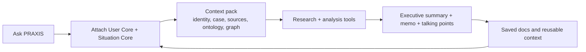

# PRAXIS by TACITUS

TACITUS builds AI data infrastructure for policy and political analysis.
PRAXIS puts that infrastructure into a research workspace: Context Capsules
connect source passages, ontology and semantic graph records, qualifications,
and revisable research memory to a specific analytical task. This “second
brain” keeps evidence, assumptions and open questions available for inspection
and correction. Saliency and efficiency are design and research goals;
measured improvements in analytical quality have not been established.

PRAXIS helps policymakers and analysts ask questions, examine narratives and
write reviewable briefs using their sources and saved ContextCapsules.
Start in Home to ask or draft; use Capsules to create, inspect and review
reusable context. Research, source receipts, memo editing and agent approvals
stay inside the existing workbench.

The [current release record](docs/reviews/2026-09-30-praxis-live-release.md)
tracks the served source, verified workflows and remaining limits. See the
[80-item improvement analysis](docs/reviews/2026-09-30-praxis-improvement-analysis.md)
and [anti-slop review](docs/reviews/2026-09-30-praxis-antislop-review.md).
Generated writing still requires human review.

Live app:

- Public front door: `https://praxis.tacitus.me`
- Authenticated workspace: `/app/*`
- Current frontend service: `praxis-frontend` on GCP Cloud Run

Business / funding snapshot:

- Funder-facing pack: `docs/product/PRAXIS_FUNDING_AND_PITCH_PACK.md`
- Product: ContextCapsule-native policy workspace by TACITUS.
- Buyers: individual policy practitioners, mediation teams, research desks,
  public-interest organizations, and institutions that need governed AI work.
- Plans: Free starter workspace; Practitioner is configured at `$49/month`,
  with checkout currently disabled. Team (`$199/month per seat`) and
  Institution plans are proposals.
- Funding focus: finish the sourceable policy-workflow loop, harden trusted
  agent runs, expand institutional controls, and support responsible pilots.

Current product direction:

- Public Home is the front door; the signed-in product stays Home + Capsules.
- Ask PRAXIS first, inside the shared cockpit/workbench rather than a
  separate primary app page.
- ContextCapsules, User Cores, Situation Cores, sources, time, graph, tools,
  output, and memory as the main context model
- Research, source intake, graph review, stakeholder mapping, scenario / ACH,
  memo drafting, brief export, diagnostics, and red-team review as panels or
  actions inside the current cockpit
- Tools stay attachable to context and are surfaced by recommendation, not
  by tool-marketplace sprawl
- Legacy signed-in URLs may redirect or deep-link for compatibility, but new
  product work lands in the shared cockpit/workbench.
- Tasklet-style persistent agents are built on the existing GCP stack: Cloud
  Run, Cloud SQL Postgres, Firestore, Cloud Tasks, Pub/Sub, Cloud Scheduler,
  Vertex AI, Cloud Storage, Secret Manager, and Cloud Monitoring.

This repository is the working source of truth for the frontend, the app API
layer, the shared context model, the tool registry, and the deploy pipeline.
If you are here to continue implementation, read `CLAUDE.md`, `AGENTS.md`,
and `ARCHITECTURE.md` first.

Current build control files:

- `docs/README.md` - documentation map and hygiene policy.
- `docs/product/README.md` - product documentation index.
- `docs/product/PRAXIS_CANONICAL_APP_STRUCTURE.md` - canonical app/runtime
  structure.
- `docs/product/CONTEXT_CAPSULE_POLICY_RESEARCH_GUIDE.md` - policy capsule
  anatomy, personas, paths, connectors, outputs, and combination rules.
- `docs/audits/2026-05-30-red-flags-and-improvement-plan.md` - current red
  flags, top 10 improvements, and docs cleanup decision.
- `docs/product/PRAXIS_FUNDING_AND_PITCH_PACK.md` - funder-facing elevator
  pitch, business model, funding needs, and textual pitch deck.
- `docs/build/PRAXIS_CONTEXT_CAPSULE_APP_BUILD_LEDGER_2026-05-15.md` - active
  implementation ledger and queue.
- `docs/build/PRAXIS_TASKLET_RUNTIME_AGENT_PROMPTS.md` - paste-ready Codex and
  Claude Code prompts for the next sessions.

---

## What PRAXIS Is For

PRAXIS exists because policy teams do not get reliable output from generic
chat alone. Real policy work depends on:

- who is asking;
- what situation they are working on;
- what sources are trusted;
- which institutions, stakeholders, and constraints matter;
- what type of output is needed;
- what should be challenged before the memo is drafted.

PRAXIS makes that context explicit and reusable. The system is designed for
foreign policy, political analysis, diplomacy, sanctions, humanitarian work,
legal review, strategic planning, and similar workflows where evidence,
structure, and provenance matter.

Typical examples:

- "I am a political analyst working on Sudan. Build a treaty analysis memo."
- "Review the public UN Security Council calendar and surface what matters."
- "Take this media report and turn it into talking points with citations."
- "Create a timeline for this context core and show the main actors."
- "Review a policy proposal, characterize the stakeholder positions, and
  draft a decision memo."

---

## Product Model

PRAXIS is organized around a small set of durable concepts.

| Layer | Purpose |
|---|---|
| **Ask PRAXIS** | Start with the question and let the app pull in the right context. |
| **ContextCapsule** | The inheritable working object: user, situation, sources, time, graph, tools, output, memory, and handover rules. |
| **User Core** | The analyst, team, institution, tone, method, and constraints. |
| **Situation Core** | The case, actors, sources, timeline, risks, and open questions. |
| **Capsule Library** | Create, select, fork, inspect, and manage capsules and cores. |
| **Agent Runs** | Durable capsule-aware work: plans, tool calls, approvals, outputs, retries, and audit events. |
| **Policy Graph** | Structured entities, relationships, provenance, and changes over time. |
| **Tools** | Research, source intake, graph review, stakeholder map, ACH, memo drafting, export, red team. |
| **Docs Library** | The writing surface where evidence becomes a brief, memo, or talking points. |

Current capsule catalog: `2026-05-30-capsule-consolidation-expert-grade-v15`.
The starter catalog has 205 situation, tool, output, and user capsules with
sourceability, tacit-knowledge, ontology, graph-proposal, output-goal, and
human-review contracts for PRAXIS augmented generation.

The app should feel like this:



---

## App Shape

The real product surface should stay simple:

- `/` is the public Home and prompt entry.
- `/app` is the signed-in Home cockpit.
- Capsule library, Ask PRAXIS, memo drafting, canvas/source work, diagnostics,
  and agent work appear as cockpit panels/actions inside the signed-in shell.
- Pricing and release notes remain public support pages.
- Legacy routes such as `/app/assistant`, `/app/dashboard`, `/app/contexts`,
  `/app/tools`, and focused agent deep links may remain as redirects or
  compatibility entry points, but they are not new primary navigation.

The public Home should point into this experience, not compete with it.

---

## Repository Layout

```text
src/app/             Next.js routes for public site, auth, app shell, API
src/components/      Shared UI for Ask PRAXIS, dashboard, workbench, tools
src/lib/             Auth, context, tools, AI, data, graph, and utilities
backend/             Python FastAPI backend and graph pipeline
cloud_functions/     GCP event handlers and ingestion workers
infrastructure/      Deploy scripts and cloud setup helpers
docs/                Architecture, build notes, audits, and runbooks
tests/               Playwright, Vitest, and workflow coverage
graphify-out/        Repo knowledge graph output and audit report
```

If you want a deeper system view, start with `ARCHITECTURE.md` and the
documents indexed under `docs/product/README.md`. Older v4/v5/v7 files remain
historical references unless the active ledger explicitly assigns them.

---

## Local Setup

```bash
git clone https://github.com/sargonxg/A4_PRAXIS_CLOUD_Work.git
cd A4_PRAXIS_CLOUD_Work
npm install
```

### Prepare a policy task locally

After installing the existing lockfile dependencies with `npm ci`, run this
workflow from the repository root. It needs no account, model credentials,
hosted PRAXIS instance or database. The fixture is entirely fictional;
its author/reviewer identities and recorded decisions demonstrate the schema,
not real expert review or a factual policy assessment.

```bash
npm run praxis -- capsule inspect tests/fixtures/cognitive-capsule/policy-context.json
npm run praxis -- capsule task tests/fixtures/cognitive-capsule/policy-context.json --objective "Draft a policy brief distinguishing authorization from expenditure. Cite the supplied passages and keep missing transfer evidence explicit." --scope public-finance --as-of 2026-11-07 --role domain-specialist --max-bytes 16000
npm run praxis -- capsule task tests/fixtures/cognitive-capsule/policy-context.json --objective "Draft a policy brief distinguishing authorization from expenditure. Cite the supplied passages and keep missing transfer evidence explicit." --scope public-finance --as-of 2026-11-07 --role domain-specialist --max-bytes 16000 --output /tmp/praxis-policy-task --allow-write
npm run praxis -- capsule reopen /tmp/praxis-policy-task --format prompt
```

The task preview shows exact source quotations, source/version IDs, stance and
anchor qualifications, ontology labels, selected records, guarded rules,
omissions, open research questions and the complete prompt's UTF-8 byte use.
The output is a **draft prompt**, ready for inspection or use in a separately
authorized drafting step; no answer is generated. `--max-bytes` bounds the
entire prompt, including the task and graph labels, rather than the exported
capsule or preview JSON. Oversized records and their evidence are omitted as
whole records and remain available in the source inventory.

Use a new output directory each time. The saved directory contains
`source.capsule`, `task.json` and `prompt.txt`. Reopen checks the package,
artifact/semantic digests, compiler version, view and prompt. Original native
`.capsule` bytes are preserved exactly; supported cognitive JSON is packaged
through the existing writer. Revisions start with another `capsule task`
invocation and a new directory, preserving the earlier task. Capsule knowledge
changes still use explicit edits, review and versioning; preparation never
promotes a proposal or fills an unknown.

Supported input is `cognitive-capsule/vNext` JSON or a
`tacitus-native-capsule/1` `.capsule` package. The TACITUS website's native-v2
inspector and its `tacitus-uploaded-knowledge-context/1` selection exports use
different contracts. There is no automatic conversion, interchange or review
promotion between them. See the [local CLI runbook](docs/runbooks/COGNITIVE_CAPSULE_CLI.md)
for the compatibility matrix and limits. Hosted generation and billing are
outside this local workflow.

Useful commands:

```bash
npm run dev
npm run typecheck
npm run build
npm run lint
npm run audit:repo-shape
npm run audit:gate
npm run smoke:app-usability
npm run smoke:core-flows
npm run auth-runtime:preflight
npm run test:auth-runtime
```

Authenticated browser/runtime testing needs a disposable Firebase test account.
See `docs/testing/AUTHENTICATED_RUNTIME_TEST_LANE.md` for the PowerShell setup
and the local, product, agentic, and live cloud lanes.

---

## Validation

Run the narrowest useful check while developing. Before a deploy checkpoint,
use the repo gate that matches the change surface.

Common checks:

```bash
npx tsc --noEmit
npm run build
npm run lint
npm run audit:repo-shape
npm run audit:gate
npm run audit:architecture-reference
npm run audit:gcp
node scripts/audit-ai-routes.mjs
npx vitest run
```

For UI changes, add browser verification with Playwright. For graph or
architecture changes, refresh the repo graph with:

```bash
graphify update .
```

---

## Deploy

The normal frontend deploy path is GitHub `main` -> GitHub Actions -> Cloud
Build trigger -> Cloud Run. Manual local deploys are fallback only.

```bash
npm run deploy:frontend:main-safe
```

The fallback wrapper verifies local `main` is current with `origin/main`, passes
the current commit into Cloud Build substitutions, and fails if runtime health
does not report the same served commit. `npm run deploy:frontend:cloud` remains
the lower-level Cloud Build command.

The live app URL is:

```text
https://praxis.tacitus.me
```

---

## Working With the Repo

- Keep the visible product surface small. Ask PRAXIS, cores, research, and
  drafting should stay central inside Home + Capsules.
- Prefer the shared workspace shell over one-off page layouts.
- Make tools attachable to a core and a case, not just clickable.
- Treat compatibility routes as preservation paths, not places to add new
  product surface area.
- Keep docs honest about what is live versus staged.
- Do not expose internal costs or hidden implementation details in user-facing
  copy.
- When adding or changing AI routes, keep calibration and route audits in sync.
- Treat `graphify-out/GRAPH_REPORT.md` as the fastest architecture map for
  this repo.

---

## Key Docs

- `CLAUDE.md` - canonical agent guidance for this repo
- `AGENTS.md` - startup rules, validation gate, and deploy notes
- `ARCHITECTURE.md` - architecture entrypoint
- `docs/README.md` - current documentation map and cleanup policy
- `docs/product/PRAXIS_CANONICAL_APP_STRUCTURE.md` - canonical app/product/runtime structure
- `docs/product/CONTEXT_CAPSULE_POLICY_RESEARCH_GUIDE.md` - capsule anatomy and augmented-generation contract
- `docs/audits/2026-05-30-red-flags-and-improvement-plan.md` - current red flags and top 10 improvement plan
- `docs/product/TASKLET_STYLE_PRAXIS_AGENT_RUNTIME_PLAN.md` - Tasklet-style PRAXIS agent runtime plan
- `docs/product/TASKLET_RESEARCH_INTAKE_2026-05-15.md` - external browser-agent research intake and decisions
- `docs/product/PRAXIS_FOUNDATION_COHERENCE_CHECK_2026-05-15.md` - foundation coherence check and build order
- `docs/build/PRAXIS_TASKLET_RUNTIME_AGENT_PROMPTS.md` - copy-paste prompts for Codex and Claude Code sessions
- `docs/architecture/PRAXIS_ARCHITECTURE.md` - canonical architecture bible
- `docs/architecture/PRAXIS_ARCHITECTURE_LIVE_APP_ALIGNMENT.md` - shipped vs target-state notes
- `docs/PRAXIS_CODEX_PLAYBOOK.md` - authoritative roadmap, priorities, and per-surface work packets
- `STATUS.md`, `TODO.md`, `CHANGELOG.md` - current repo status and backlog

---

## GitHub Repository Best Practices Used Here

This README is structured the way GitHub recommends for project repos:

- clear project summary at the top;
- explicit purpose and value;
- quick orientation for new contributors;
- separate setup, validation, and deployment;
- stable relative links to the repo's canonical docs;
- a visible explanation of who the project is for and why it exists.

Additional repository hygiene that belongs alongside this README:

- `LICENSE`
- `SECURITY.md`
- `CONTRIBUTING.md`
- `CODEOWNERS`
- `CITATION.cff` when citation matters

---

## Agent Guidance

If you are a Codex or Claude session continuing this repo, read these first:

1. `CLAUDE.md`
2. `AGENTS.md`
3. `ARCHITECTURE.md`
4. `docs/architecture/PRAXIS_ARCHITECTURE.md`
5. `docs/product/TASKLET_STYLE_PRAXIS_AGENT_RUNTIME_PLAN.md`
6. `docs/build/PRAXIS_CONTEXT_CAPSULE_APP_BUILD_LEDGER_2026-05-15.md`

The short version: do not widen the product surface by accident. Keep the
app centered on core context, serious analysis, and writing.
