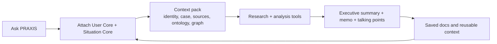

# PRAXIS by TACITUS

PRAXIS is a ContextCapsule-native policy workspace for teams that need AI
agents to work from real context, not a blank chat box. It combines Ask PRAXIS,
a managed capsule/core library, source-grounded research, memo drafting,
review-gated graph work, and persistent agent runs so analysts can move from
question to evidence to write-up to handover in one place.

Live app:

- Public front door: `https://praxis.tacitus.me`
- Authenticated workspace: `/app/*`
- Current frontend service: `praxis-frontend` on GCP Cloud Run

Current product direction:

- One shared workspace shell for dashboard and workbench
- Ask PRAXIS first
- ContextCapsules, User Cores, Situation Cores, sources, time, graph, tools,
  output, and memory as the main context model
- Research, source intake, graph review, stakeholder mapping, scenario / ACH,
  memo drafting, brief export, and red-team review as the core tool set
- Tools stay attachable to context and are surfaced by recommendation, not
  by tool-marketplace sprawl
- Tasklet-style persistent agents are built on the existing GCP stack: Cloud
  Run, Cloud SQL Postgres, Firestore, Cloud Tasks, Pub/Sub, Cloud Scheduler,
  Vertex AI, Cloud Storage, Secret Manager, and Cloud Monitoring.

This repository is the working source of truth for the frontend, the app API
layer, the shared context model, the tool registry, and the deploy pipeline.
If you are here to continue implementation, read `CLAUDE.md`, `AGENTS.md`,
and `ARCHITECTURE.md` first.

Current build control files:

- `docs/product/README.md` - product documentation index.
- `docs/product/PRAXIS_CANONICAL_APP_STRUCTURE.md` - canonical app/runtime
  structure.
- `docs/product/CONTEXT_CAPSULE_POLICY_RESEARCH_GUIDE.md` - policy capsule
  anatomy, personas, paths, connectors, outputs, and combination rules.
- `docs/build/PRAXIS_CONTEXT_CAPSULE_APP_BUILD_LEDGER_2026-05-15.md` - active
  implementation ledger and queue.
- `docs/build/PRAXIS_TASKLET_RUNTIME_AGENT_PROMPTS.md` - paste-ready Codex and
  Claude Code prompts for the next sessions.

---

## What PRAXIS Is For

PRAXIS exists because policy teams do not get reliable output from generic
chat alone. Real policy work depends on:

- who is asking;
- what situation they are working on;
- what sources are trusted;
- which institutions, stakeholders, and constraints matter;
- what type of output is needed;
- what should be challenged before the memo is drafted.

PRAXIS makes that context explicit and reusable. The system is designed for
foreign policy, political analysis, diplomacy, sanctions, humanitarian work,
legal review, strategic planning, and similar workflows where evidence,
structure, and provenance matter.

Typical examples:

- "I am a political analyst working on Sudan. Build a treaty analysis memo."
- "Review the public UN Security Council calendar and surface what matters."
- "Take this media report and turn it into talking points with citations."
- "Create a timeline for this context core and show the main actors."
- "Review a policy proposal, characterize the stakeholder positions, and
  draft a decision memo."

---

## Product Model

PRAXIS is organized around a small set of durable concepts.

| Layer | Purpose |
|---|---|
| **Ask PRAXIS** | Start with the question and let the app pull in the right context. |
| **ContextCapsule** | The inheritable working object: user, situation, sources, time, graph, tools, output, memory, and handover rules. |
| **User Core** | The analyst, team, institution, tone, method, and constraints. |
| **Situation Core** | The case, actors, sources, timeline, risks, and open questions. |
| **Core Library** | Create, select, fork, inspect, and manage cores. |
| **Agent Runs** | Durable capsule-aware work: plans, tool calls, approvals, outputs, retries, and audit events. |
| **Policy Graph** | Structured entities, relationships, provenance, and changes over time. |
| **Tools** | Research, source intake, graph review, stakeholder map, ACH, memo drafting, export, red team. |
| **Docs Library** | The writing surface where evidence becomes a brief, memo, or talking points. |

The app should feel like this:



---

## App Shape

The real app lives under `/app/*` and should stay simple:

- `/app/assistant` is the dedicated full-page Ask PRAXIS workspace.
- `/app/dashboard` is the main workspace shell.
- `/app/contexts` is the core library entry point.
- `/app/cores/user` manages User Cores.
- `/app/cores/context` manages Situation Cores.
- `/app/workbench/[caseId]` is the detailed case view when needed.
- `/app/tools` is a recommendation library, not a market stall.
- Drafting lives in the same shared shell, not in a disconnected page.

The public landing page should point into this experience, not compete with it.

---

## Repository Layout

```text
src/app/             Next.js routes for public site, auth, app shell, API
src/components/      Shared UI for Ask PRAXIS, dashboard, workbench, tools
src/lib/             Auth, context, tools, AI, data, graph, and utilities
backend/             Python FastAPI backend and graph pipeline
cloud_functions/     GCP event handlers and ingestion workers
infrastructure/      Deploy scripts and cloud setup helpers
docs/                Architecture, build notes, audits, and runbooks
tests/               Playwright, Vitest, and workflow coverage
graphify-out/        Repo knowledge graph output and audit report
```

If you want a deeper system view, start with `ARCHITECTURE.md` and the
documents indexed under `docs/product/README.md`. Older v4/v5/v7 files remain
historical references unless the active ledger explicitly assigns them.

---

## Local Setup

```bash
git clone https://github.com/sargonxg/A4_PRAXIS_CLOUD_Work.git
cd A4_PRAXIS_CLOUD_Work
npm install
```

Useful commands:

```bash
npm run dev
npm run typecheck
npm run build
npm run lint
npm run audit:repo-shape
npm run audit:gate
npm run smoke:app-usability
npm run smoke:core-flows
npm run auth-runtime:preflight
npm run test:auth-runtime
```

Authenticated browser/runtime testing needs a disposable Firebase test account.
See `docs/testing/AUTHENTICATED_RUNTIME_TEST_LANE.md` for the PowerShell setup
and the local, product, agentic, and live cloud lanes.

---

## Validation

Run the narrowest useful check while developing. Before a deploy checkpoint,
use the repo gate that matches the change surface.

Common checks:

```bash
npx tsc --noEmit
npm run build
npm run lint
npm run audit:repo-shape
npm run audit:gate
npm run audit:architecture-reference
npm run audit:gcp
node scripts/audit-ai-routes.mjs
npx vitest run
```

For UI changes, add browser verification with Playwright. For graph or
architecture changes, refresh the repo graph with:

```bash
graphify update .
```

---

## Deploy

The frontend deploy path is the Cloud Build fast path:

```bash
npm run deploy:frontend:cloud
```

That builds the Next.js frontend, wires in the live backend URL, pushes the
image, and deploys the `praxis-frontend` Cloud Run service.

The live app URL is:

```text
https://praxis.tacitus.me
```

---

## Working With the Repo

- Keep the visible product surface small. Ask PRAXIS, cores, research, and
  drafting should stay central.
- Prefer the shared workspace shell over one-off page layouts.
- Make tools attachable to a core and a case, not just clickable.
- Keep docs honest about what is live versus staged.
- Do not expose internal costs or hidden implementation details in user-facing
  copy.
- When adding or changing AI routes, keep calibration and route audits in sync.
- Treat `graphify-out/GRAPH_REPORT.md` as the fastest architecture map for
  this repo.

---

## Key Docs

- `CLAUDE.md` - canonical agent guidance for this repo
- `AGENTS.md` - startup rules, validation gate, and deploy notes
- `ARCHITECTURE.md` - architecture entrypoint
- `docs/product/PRAXIS_CANONICAL_APP_STRUCTURE.md` - canonical app/product/runtime structure
- `docs/product/TASKLET_STYLE_PRAXIS_AGENT_RUNTIME_PLAN.md` - Tasklet-style PRAXIS agent runtime plan
- `docs/product/TASKLET_RESEARCH_INTAKE_2026-05-15.md` - external browser-agent research intake and decisions
- `docs/product/PRAXIS_FOUNDATION_COHERENCE_CHECK_2026-05-15.md` - foundation coherence check and build order
- `docs/build/PRAXIS_TASKLET_RUNTIME_AGENT_PROMPTS.md` - copy-paste prompts for Codex and Claude Code sessions
- `docs/architecture/PRAXIS_ARCHITECTURE.md` - canonical architecture bible
- `docs/architecture/PRAXIS_ARCHITECTURE_LIVE_APP_ALIGNMENT.md` - shipped vs target-state notes
- `docs/audits/2026-05-16-tasklet-codebase-cleanup-audit.md` - current cleanup ledger
- `STATUS.md`, `TODO.md`, `CHANGELOG.md` - current repo status and backlog

---

## GitHub Repository Best Practices Used Here

This README is structured the way GitHub recommends for project repos:

- clear project summary at the top;
- explicit purpose and value;
- quick orientation for new contributors;
- separate setup, validation, and deployment;
- stable relative links to the repo's canonical docs;
- a visible explanation of who the project is for and why it exists.

Additional repository hygiene that belongs alongside this README:

- `LICENSE`
- `SECURITY.md`
- `CONTRIBUTING.md`
- `CODEOWNERS`
- `CITATION.cff` when citation matters

---

## Agent Guidance

If you are a Codex or Claude session continuing this repo, read these first:

1. `CLAUDE.md`
2. `AGENTS.md`
3. `ARCHITECTURE.md`
4. `docs/architecture/PRAXIS_ARCHITECTURE.md`
5. `docs/product/TASKLET_STYLE_PRAXIS_AGENT_RUNTIME_PLAN.md`
6. `docs/build/PRAXIS_CONTEXT_CAPSULE_APP_BUILD_LEDGER_2026-05-15.md`

The short version: do not widen the product surface by accident. Keep the
app centered on core context, serious analysis, and writing.
