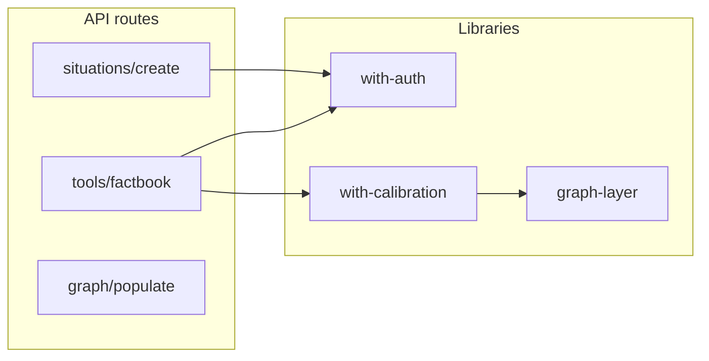

# PRAXIS comprehensive codebase audit

## Goal

Produce an honest, evidence-grounded map of the PRAXIS codebase as it
actually exists today — not as the docs describe it, not as the
architecture intends it, but as the bytes on disk and the call graphs
they form. From that map, generate a prioritized cleanup plan: what
can be deleted (dead code), what should be merged (duplicate paths),
what should be split (god objects), what should be renamed (lying
labels), and what should be left alone (load-bearing complexity).

This is **read-only work** until the cleanup plan is approved.
Codex builds the audit, GC reviews it, only then does a follow-up
pack execute deletions. The risk of an unsupervised "clean it up"
loop is too high — Codex can confidently delete code that's actually
hot-loaded at runtime. So: report first, act later.

The deliverable is a folder of evidence (machine-readable inventory,
graph artifacts, per-finding files) and a synthesis report. Anyone
opening that folder should be able to understand the codebase's real
shape in 20 minutes.

## Pre-conditions

1. Repo is checked out at the branch you want audited (`main` or a
   feature branch — document which in the report).
2. Working tree is clean (`git status --short` is empty). The audit
   produces files; nothing else should be in flight.
3. `node`, `npm`, `python3`, `pip` available. Codex installs additional
   tooling per Phase 0.
4. Skills `praxis-conventions` from /mnt/skills/user/ is loaded —
   covers file layout, model strings, security boundaries.

## Hard rules

1. **No deletions.** Codex never removes a file or modifies code in
   this audit. The output is documentation and machine-readable
   inventory. The cleanup pack that follows uses this audit as input.
2. **No autonomous loops on uncertainty.** When Codex isn't sure
   whether code is live or dead (e.g., dynamic imports, runtime route
   resolution), it lists the ambiguity in the `unknowns.md` file and
   moves on. Speculation is failure mode.
3. **Evidence over inference.** Every claim in the report has a
   citation: file path, line number, command output, or graph node id.
   Claims without evidence go in `unknowns.md` for follow-up.
4. **Don't trust the docs.** The architecture docs describe intent;
   they may not match reality. When the audit and docs disagree,
   document the gap. Don't patch the docs in this pass.
5. **Time-box each phase.** A phase that overruns by 2x suggests the
   approach is wrong. Stop, document what was found, surface to GC
   before continuing.

## Files Codex must read first

Before any tools run, read these to anchor the work:

- `package.json` — what's installed, what scripts exist
- `pyproject.toml` and `requirements.txt` — Python deps
- `next.config.*` — Next configuration
- `firebase.json` and `firestore.rules` — runtime surfaces
- `cloudbuild.yaml` — deploy pipeline
- Top-level `README.md` — claimed shape
- `docs/architecture/` directory — intended shape
- `STATUS.md` and `BLOCKERS.md` if present — known issues

Capture key facts in `docs/audits/<date>-CODEBASE_AUDIT/00-context.md`:

- Branch + HEAD sha
- Date + audit author (Codex)
- Counts: files, lines, packages, routes (rough — refined in Phase 1)
- Architecture documents read and their stated claims

## Output structure

Everything goes under `docs/audits/<date>-CODEBASE_AUDIT/`. The
`<date>` is ISO format. The folder structure:

```
docs/audits/<date>-CODEBASE_AUDIT/
├── 00-context.md                      Phase 0 anchor
├── 01-inventory/
│   ├── files.json                     Every file with metadata
│   ├── modules.json                   TS/JS modules with imports/exports
│   ├── routes.json                    Every API route + method
│   ├── ui-surfaces.json               Pages, components, hooks
│   ├── env-vars.json                  Every env var read
│   ├── feature-flags.json             Every flag and its readers
│   ├── deps-frontend.json             package.json deps + actual usage
│   ├── deps-backend.json              Python deps + actual usage
│   └── tools-installed.md             Tools used to build this
├── 02-graphs/
│   ├── module-graph.dot               Module dependency graph
│   ├── module-graph.mermaid           Same, viewer-friendly
│   ├── route-graph.mermaid            API routes by namespace
│   ├── data-flow.mermaid              Frontend → API → Backend → KG
│   ├── orphan-modules.md              Modules with zero imports in
│   ├── hub-modules.md                 Modules with too many imports in
│   └── cycles.md                      Circular dependencies
├── 03-dead-code/
│   ├── unused-exports.md              From knip / ts-prune
│   ├── unused-files.md                Files with zero importers
│   ├── unused-deps-frontend.md        From depcheck
│   ├── unused-deps-backend.md         From pip-tools / vulture
│   ├── dead-routes.md                 Routes with no consumer
│   ├── dead-env-vars.md               Env vars set but unread (or vice versa)
│   ├── dead-feature-flags.md          Flags always-on or always-off
│   └── deletion-candidates.md         Synthesis: ranked deletion list
├── 04-duplications/
│   ├── code-clones.md                 jscpd output, filtered + annotated
│   ├── parallel-implementations.md    Two ways to do same thing
│   ├── near-duplicate-routes.md       Endpoints that should be merged
│   └── consolidation-candidates.md    Synthesis: ranked merge list
├── 05-hotspots/
│   ├── oversized-files.md             > 500 lines
│   ├── overcomplex-functions.md       Cyclomatic > 15
│   ├── god-modules.md                 Hub modules that should split
│   ├── boundary-leaks.md              Frontend reaching past backend
│   ├── lying-labels.md                Names that don't match behavior
│   └── refactor-candidates.md         Synthesis: ranked split/rename list
├── 06-surface-area/
│   ├── public-api-surface.md          Routes the world can call
│   ├── undocumented-routes.md         Routes not in docs
│   ├── orphan-routes.md               Routes never called by UI
│   ├── lying-routes.md                Routes whose behavior doesn't match name/path
│   └── surface-recommendations.md     Synthesis
├── 07-cleanup-plan.md                 THE deliverable — prioritized
├── 08-unknowns.md                     Things Codex couldn't resolve
└── 09-summary.md                      For GC, 1-page overview
```

The two files GC will actually read first: `09-summary.md` and
`07-cleanup-plan.md`. Everything else is evidence.

---

## Phase 0 — Tooling and context (15 minutes)

### Tasks

1. Install audit tooling (idempotent):

   ```bash
   # Frontend
   npm install --no-save --silent \
     knip \
     depcheck \
     madge \
     jscpd \
     ts-prune

   # Python (backend)
   pip install --quiet vulture pipdeptree pip-audit
   ```

2. Confirm `rg`, `jq`, `dot` are present:

   ```bash
   which rg jq dot || echo "missing tools"
   ```

   If `dot` (graphviz) is missing, fall back to mermaid-only graphs.

3. Capture context to `00-context.md`:

   - `git rev-parse HEAD`
   - `git log --oneline -10`
   - `node --version`, `npm --version`, `python3 --version`
   - `find . -type f -name "*.ts" -o -name "*.tsx" -o -name "*.py" | wc -l`
   - `find src -type f | wc -l`, same for `backend`, `cloud_functions`,
     `infrastructure`
   - Architecture docs found and their key claims (1 paragraph each)

4. List the tools you installed, their version, and what each will be
   used for, in `01-inventory/tools-installed.md`.

### Acceptance for Phase 0

`00-context.md` exists and contains: branch, sha, file counts, dep
counts, doc inventory, tool inventory.

---

## Phase 1 — Inventory (1-2 hours)

The goal is to enumerate everything that exists. No interpretation
yet. JSON files for machine consumption; markdown stays minimal.

### 1.1 — Files

Walk the repo, produce `01-inventory/files.json`:

```json
{
  "files": [
    {
      "path": "src/app/api/situations/create/route.ts",
      "kind": "route",                 // route | component | lib | test | config | doc | script
      "lines": 127,
      "ext": "ts",
      "size_bytes": 4521,
      "last_modified": "2026-04-12T..."
    }
  ]
}
```

Use `find` + `wc -l` + a small tsx script:

```bash
# Example shape
find . \( -path ./node_modules -prune \) -o \( -path ./.next -prune \) -o \
  -type f \( -name "*.ts" -o -name "*.tsx" -o -name "*.js" -o -name "*.jsx" -o -name "*.py" -o -name "*.md" -o -name "*.yaml" -o -name "*.json" -o -name "*.sh" \) -print
```

Classify each file by `kind`:
- under `src/app/api/**/route.ts` → `route`
- under `src/components/**` or `src/app/**` (not route) → `component`
- under `src/lib/**` or `backend/services/**` → `lib`
- under `tests/**` or matching `*.test.*` → `test`
- under `infrastructure/**`, `cloudbuild.yaml`, top-level configs → `config`
- under `docs/**` → `doc`
- under `scripts/**` → `script`
- everything else → `other`

### 1.2 — Modules

For each `*.ts`/`*.tsx`/`*.js`/`*.jsx` (frontend) and `*.py` (backend):
extract imports and exports.

Frontend (TypeScript): use `madge --json src/` to produce the import
graph. Augment with TypeScript AST for exports — `ts-prune --json`
returns unused exports; the per-file output also gives the export list.

Backend (Python): walk `import` and `from X import Y` statements
manually with a small AST script or `pipdeptree` for top-level deps,
plus `vulture --min-confidence 80` for dead-code candidates.

`01-inventory/modules.json`:

```json
{
  "modules": [
    {
      "path": "src/lib/api/with-calibration.ts",
      "exports": ["withCalibration", "buildToolContext"],
      "imports": [
        "@/lib/firebase/admin",
        "@/lib/calibration/snapshot",
        "@/types/situation"
      ],
      "imported_by": [
        "src/app/api/tools/factbook/route.ts",
        "src/app/api/tools/ach/route.ts"
      ],
      "lines": 287,
      "complexity_estimate": 22
    }
  ]
}
```

`imported_by` is built by inverting the import graph.

### 1.3 — Routes

Walk `src/app/api/**/route.ts` (Next.js App Router) and any other
route entry points. For each, extract: HTTP methods, handler name,
auth wrapper used, calibration wrapper used, request/response shape
if statically inferable.

Backend FastAPI: walk `backend/routers/*.py` or wherever routes live;
extract `@router.get/.post/...` decorators.

`01-inventory/routes.json`:

```json
{
  "routes": [
    {
      "kind": "next",
      "path": "/api/situations/[caseId]",
      "method": "GET",
      "file": "src/app/api/situations/[caseId]/route.ts",
      "auth": "withAuth",
      "calibration": null,
      "lines": 89,
      "consumers": []     // Phase 3 fills this in
    },
    {
      "kind": "fastapi",
      "path": "/api/v1/kg/dual-write/upsert-nodes",
      "method": "POST",
      "file": "backend/routers/kg.py:42",
      "auth": "get_user_ctx",
      "calibration": null,
      "lines": 28,
      "consumers": []
    }
  ]
}
```

### 1.4 — UI surfaces

Pages, components, hooks. For each `src/app/**/page.tsx`:

```json
{
  "kind": "page",
  "route": "/app/workbench",
  "file": "src/app/app/workbench/page.tsx",
  "uses_components": ["WorkbenchHeader", "ChapterRenderer"],
  "uses_hooks": ["useEffectiveRole", "useCalibration"],
  "uses_routes": ["/api/situations/{caseId}", "/api/situations/{caseId}/access"]
}
```

Component and hook lists come from the JSX tree + import statements.
"Uses routes" comes from `fetch('/api/...')` and any `useSWR(...)`
patterns — grep for `fetch\(['"\\\`]/api`.

### 1.5 — Env vars

Find every `process.env.*` (frontend) and `os.environ.*` /
`os.getenv(...)` (backend):

```bash
rg "process\\.env\\.[A-Z_][A-Z0-9_]*" --type ts --type tsx -o | sort -u
rg "(os\\.environ|os\\.getenv)\\(['\"][A-Z_][A-Z0-9_]*['\"]" --type py -o | sort -u
```

Also walk `.env*` files, `cloudbuild.yaml` substitutions, Cloud Run
env vars from infrastructure files.

`01-inventory/env-vars.json`:

```json
{
  "env_vars": [
    {
      "name": "COGNEE_BACKEND_URL",
      "read_in": ["src/lib/knowledge/cognee-client.ts:12"],
      "set_in_env_files": [".env.example"],
      "set_in_infra": ["infrastructure/cloudrun/monolith.yaml"],
      "documented": true,
      "documented_in": ["docs/architecture/MEMORY_LAYER.md"]
    }
  ]
}
```

### 1.6 — Feature flags

Walk for flag patterns:

```bash
rg "useFeatureFlag\\(['\"][a-z_-]+['\"]\\)" --type ts --type tsx
rg "FEATURE_[A-Z_]+" --type ts --type tsx
rg "process\\.env\\.[A-Z_]+_ENABLED" --type ts --type tsx
```

Same for backend if the pattern exists.

`01-inventory/feature-flags.json`: name, type (env | runtime | code-const),
read sites, set sites, default value.

### 1.7 — Dependencies

Frontend: `package.json` × `depcheck`. For each declared dep, was it
actually imported anywhere?

```bash
npx depcheck --json > /tmp/depcheck.json
```

Backend: `requirements.txt` (or `pyproject.toml`) × actual imports.
Use a small Python script to walk `import X` and cross-reference.

### Acceptance for Phase 1

`01-inventory/` directory has all 8 JSON/markdown files. Each is
non-empty. `files.json` has > 100 entries (PRAXIS is large enough).
`routes.json` has both `kind: next` and `kind: fastapi` entries.

---

## Phase 2 — Graph (1 hour)

The graph is the analytical centerpiece. Build it once, query it many
times.

### 2.1 — Module dependency graph

From `01-inventory/modules.json`, produce:

**`02-graphs/module-graph.dot`** — full graphviz dot file. Each
module is a node; each import is a directed edge.

**`02-graphs/module-graph.mermaid`** — pruned, viewer-friendly
version. Cluster modules by their top-level path
(`src/app/api/**` → cluster "API routes", `src/lib/**` → cluster
"Libraries", etc.). Hide test files and config files. Include only
edges where source AND target are in the included set.



**`02-graphs/route-graph.mermaid`** — API surface clustered by
namespace prefix (`/api/situations`, `/api/tools`, `/api/graph`,
`/api/orgs`, etc.).

**`02-graphs/data-flow.mermaid`** — high-level flow showing how a
typical hero-tool run traverses frontend → API → calibration →
graph/memory → model → response.

### 2.2 — Orphan modules

From the graph, find modules where `imported_by` is empty AND the
module isn't an entry point (route, page, script, config). Write to
`02-graphs/orphan-modules.md`:

```markdown
# Orphan modules

These modules are not imported anywhere AND are not entry points.
Strong deletion candidates pending Phase 6 verification.

| module | lines | exports | risk-of-removal | notes |
|---|---|---|---|---|
| src/lib/old-graph-helper.ts | 142 | 3 | low | None of the 3 exports appear anywhere. Pre-Postgres-cutover code. |
| src/components/legacy/SidebarOld.tsx | 89 | 1 | low | Replaced by new Sidebar; reference in LegacyPage which is also orphan |
```

Risk-of-removal:
- **low**: zero importers, zero references in any string anywhere
- **medium**: zero static importers but referenced in dynamic
  imports / strings / tests
- **high**: appears load-bearing despite no static importers
  (e.g., loaded by Next.js convention)

### 2.3 — Hub modules

Find modules with `> 15` importers. These are god-objects-in-waiting.
`02-graphs/hub-modules.md`:

```markdown
# Hub modules (potential god-objects)

| module | importers | lines | exported symbols | concern |
|---|---|---|---|---|
| src/lib/situations/access.ts | 47 | 89 | 6 | Healthy — small focused helper, naturally widely used |
| src/lib/firebase/admin.ts | 38 | 156 | 12 | Healthy — DB connection module |
| src/lib/utils.ts | 31 | 412 | 28 | UNHEALTHY — grab-bag, see hotspots |
```

Hubs are not automatically bad. Annotate each with concern level:
healthy hub vs unhealthy hub.

### 2.4 — Cycles

`02-graphs/cycles.md`. Run `madge --circular src/`. Each cycle is a
red flag — usually a sign of a broken abstraction.

```markdown
# Circular dependencies

| cycle | length | recommended fix |
|---|---|---|
| A → B → C → A | 3 | Extract shared types to D; A and C import D |
| X → Y → X | 2 | Move the shared symbol to a third module |
```

### Acceptance for Phase 2

The four graphs render. Open `module-graph.mermaid` in a mermaid
viewer (or paste into mermaid.live) — it's readable. Orphan, hub,
cycle inventories are all populated (or explicitly empty with a note).

---

## Phase 3 — Dead code (1-2 hours)

Cross-reference Phase 1 inventories with Phase 2 graphs. For every
candidate, verify with multiple methods before listing.

### 3.1 — Unused exports

Run knip (preferred — covers more cases than ts-prune):

```bash
npx knip --reporter json > /tmp/knip.json
```

Knip finds: unused files, unused exports, unused dependencies, unused
exports in dependencies, unresolved imports, duplicate exports.

For each unused export, verify with a second method before listing
as dead:

```bash
SYMBOL="exportedFunctionName"
rg "$SYMBOL" --type ts --type tsx \
  --glob '!**/*.test.ts' --glob '!**/*.test.tsx'
```

If `rg` finds the symbol referenced as a string, in a comment, or
in dynamic import, mark as `risk: medium` not `low`.

`03-dead-code/unused-exports.md`:

```markdown
# Unused exports

Verified with knip + ripgrep. Risk levels:
- **low**: knip flagged + zero ripgrep hits outside the export site
- **medium**: knip flagged but ripgrep finds string references (might
  be dynamically loaded)
- **high**: knip flagged but appears in route conventions or
  framework hooks (Next.js conventions, React components named
  ComponentName.displayName, etc.)

| symbol | file | risk | evidence |
|---|---|---|---|
| `legacyComputeScore` | src/lib/scoring/legacy.ts:34 | low | knip flagged; rg returns only the export site |
| `OldFooBarHandler` | src/app/api/foo/route-old.ts:12 | medium | knip flagged; rg finds reference in tests/legacy-foo.test.ts |
```

### 3.2 — Unused files

Files where the entire export surface is unused, OR files that knip
flags as unused. Verify with: zero importers in `modules.json` AND
no string references to the file path.

`03-dead-code/unused-files.md` — same risk classification.

### 3.3 — Unused dependencies (frontend)

```bash
npx depcheck --json | jq -r '.dependencies'
```

For each candidate, do a deeper check. Sometimes depcheck misses:
- Deps used only in scripts (allow if used in `scripts/*`)
- Deps used in CSS / build tooling (Tailwind plugins, PostCSS)
- Deps loaded by configuration (next.config.js, etc.)

`03-dead-code/unused-deps-frontend.md` annotates each with the
verification result.

### 3.4 — Unused dependencies (backend)

Compare `requirements.txt` vs actual imports. For each declared dep,
search for `import X` or `from X import` — if none, it's unused.

```bash
# Get all imports
rg "^(import|from) " backend cloud_functions --type py -o | sort -u > /tmp/imports.txt

# Cross-reference with requirements.txt
while read -r dep; do
  pkg=$(echo "$dep" | sed 's/[<>=].*//')
  if ! grep -q "$pkg" /tmp/imports.txt; then
    echo "$pkg unused?"
  fi
done < requirements.txt
```

Some Python deps are imported via aliases (`numpy as np`) — handle
the common cases.

### 3.5 — Dead routes

A route is dead if no UI surface fetches it AND no other backend
service calls it AND no documentation describes it as a public API.

Cross-reference `routes.json` × `ui-surfaces.json` × any
documentation route lists. The intersection of "in routes.json" and
NOT "consumed by any UI/integration" is the dead set.

For ambiguity (route consumed by an integration that isn't a UI
surface in the repo, e.g., an external MCP client), mark
`risk: medium`.

`03-dead-code/dead-routes.md`:

```markdown
# Dead routes

| route | method | file | last_modified | risk | notes |
|---|---|---|---|---|---|
| /api/internal/old-graph-export | GET | src/app/api/internal/old-graph-export/route.ts | 2025-09-... | low | No UI fetch; predates the export endpoint at /api/exports/* |
| /api/v1/kg/legacy-search | POST | backend/routers/kg.py:88 | 2025-... | medium | Possibly used by MCP client — verify with GC |
```

### 3.6 — Dead env vars

From `env-vars.json`, find vars that are SET (in env files or infra)
but never READ in code. Or READ in code but never set anywhere.

`03-dead-code/dead-env-vars.md`:

```markdown
# Dead environment variables

## Set but unread (config rot)

| var | set in | last sighted | recommendation |
|---|---|---|---|
| OLD_LANGCHAIN_KEY | infrastructure/cloudrun/monolith.yaml | 2025-08-... | remove from infra |

## Read but unset (likely silent breakage)

| var | read in | recommendation |
|---|---|---|
| EXPECTED_BUT_NEVER_SET | src/lib/foo.ts:12 | confirm if this is intentional defaulting or bug |
```

### 3.7 — Dead feature flags

From `feature-flags.json`, find flags that are:
- Always-on in production (default true, never explicitly false in
  any env)
- Always-off in production (default false, never enabled)
- Read but the read-site is itself dead code

`03-dead-code/dead-feature-flags.md` lists candidates with
recommendation: inline the always-on, delete the always-off, remove
the dead read-site.

### 3.8 — Synthesis: deletion candidates

`03-dead-code/deletion-candidates.md` — the synthesis. Every item
across 3.1–3.7 ranked by:

- **Confidence (low/medium/high)** that it's actually dead
- **Lines saved** if removed
- **Risk of breakage** if removed
- **Action**: delete | inline | rename | investigate

Sort by `(confidence == high) AND (risk == low)` first — the easy
wins.

```markdown
# Deletion candidates (ranked)

## Tier 1 — Easy wins (high confidence, low risk)

| item | kind | lines | action |
|---|---|---|---|
| src/lib/scoring/legacy.ts | unused-file | 142 | delete entire file |
| dep `lodash.omit` | unused-dep | n/a | npm uninstall |
| FEATURE_OLD_GRAPH_PREVIEW | dead-flag | 8 | inline (always false) |

## Tier 2 — Likely safe (high confidence, medium risk)

...

## Tier 3 — Investigate (medium confidence)

...
```

### Acceptance for Phase 3

Each of 3.1–3.7 has a populated markdown file (or explicitly empty
with a note: "no findings in this category"). Synthesis file lists at
least N items in Tier 1 or explains why nothing qualifies.

---

## Phase 4 — Duplications (1 hour)

### 4.1 — Code clones

Run `jscpd`:

```bash
npx jscpd src backend --reporters json --output /tmp/jscpd
```

jscpd finds duplicate code blocks across the repo. Filter the report:
- Drop duplicates < 30 lines (too noisy)
- Drop duplicates inside test files
- Drop duplicates that are auto-generated (migrations, snapshots)

For each remaining duplicate, write a section in
`04-duplications/code-clones.md`:

```markdown
## Clone group: <descriptive title>

**Locations**:
- `src/app/api/foo/route.ts:42-89` (47 lines)
- `src/app/api/bar/route.ts:38-91` (53 lines)

**Pattern**: Both routes hand-roll the same auth + validation +
firestore-write sequence.

**Recommendation**: Extract to `src/lib/api/standard-mutation.ts`,
have both routes call it. Estimated savings: ~80 lines.

**Risk**: Low. The two routes have diverged slightly in error
messages — preserve the differences in the helper's options.
```

### 4.2 — Parallel implementations

Two files that do the same thing in different ways. jscpd doesn't
catch these (different code, same purpose). Find by:

1. Search for telltale name patterns: `*-old`, `*-legacy`, `*-v1`,
   `*-deprecated`, `*-new`, `*-v2`
2. Search for parallel folder structures: `src/lib/foo/` and
   `src/lib/foo-v2/`
3. Routes with similar paths: `/api/ai/deep-research` and
   `/api/ai/deep-search-agent`

`04-duplications/parallel-implementations.md`:

```markdown
| set | files | recommendation |
|---|---|---|
| Deep research routes | /api/ai/deep-research, /api/ai/deep-search-agent | Pick canonical, deprecate other (Z3 in v2 pack) |
| Document upload paths | /api/documents/upload, /api/situations/[id]/documents/upload | Merge: one endpoint, situation context as param |
```

### 4.3 — Near-duplicate routes

Routes whose paths look similar enough that they probably overlap:

```
/api/situations/[caseId]/graph
/api/graph/[caseId]
/api/v1/kg/read/graph/[case_id]
```

Three routes for "get the graph for a case." Document each one's
actual behavior (the small Phase 1 inventory of route files makes
this fast), then recommend the consolidation.

### 4.4 — Synthesis: consolidation candidates

`04-duplications/consolidation-candidates.md` — ranked merge list.
Same structure as Phase 3's synthesis: confidence, savings, risk,
action.

### Acceptance for Phase 4

Each section populated. Synthesis lists at least the obvious
duplications (deep-research, route family overlaps).

---

## Phase 5 — Hot-spots (1 hour)

### 5.1 — Oversized files

Threshold: 500 lines (Codex can adjust). For each:

```markdown
## src/lib/api/with-calibration.ts — 768 lines

**Responsibilities** (extracted from the file):
- Auth context resolution
- Tool context build
- Calibration snapshot
- Refusal logic
- Compensation logic
- Telemetry emission
- Error formatting

**Recommendation**: Extract to:
- `with-calibration.ts` (orchestrator, ~150 lines)
- `calibration/build-context.ts` (~200 lines)
- `calibration/refusal.ts` (~80 lines)
- `calibration/compensation.ts` (~60 lines)
- `calibration/snapshot.ts` (already exists, expand)

**Risk**: Medium. This module is the calibration core; refactor with
test coverage in place. Done after the v2 audit-log work since A6
adds emit calls that should land in cleanly-extracted helpers.
```

### 5.2 — Overcomplex functions

Cyclomatic complexity > 15. Use a complexity tool or AST script:

```bash
# Approx via lines + branching keywords
rg -c "if|else|for|while|case|catch|\\?\\?|\\|\\|" path/to/file.ts
```

Or proper tooling:

```bash
npx complexity-report-html src/ --output /tmp/complexity || true
# Or use eslint complexity rule with --max-complexity 15
```

For each function over the threshold, document and recommend a refactor.

### 5.3 — God modules

From Phase 2's hub list, the unhealthy ones. Each gets a section:
why it's a grab-bag, what should split off, what should stay.

### 5.4 — Boundary leaks

Two patterns to find:

**Frontend reaching past the backend**: a Next route that talks
directly to Firestore, Postgres, or Vertex when it should go through
FastAPI for the heavy lift. Or vice versa: backend producing UI
strings.

```bash
rg "@google-cloud/firestore|firebase-admin/firestore" src/app --type ts
rg "openai\\.|anthropic\\.|@google-cloud/aiplatform" src/app --type ts
```

**Test fixtures used in production code**:

```bash
rg "from ['\"].+/test/|from ['\"].+/__mocks__" src/lib src/app --type ts
```

### 5.5 — Lying labels

Names that don't match behavior. Common patterns:
- A function called `validate*` that mutates
- A type called `Read*Request` used for writes
- A route at `/api/internal/*` consumed by the public UI
- A subcollection called `cache` that's actually durable storage
- A flag called `enabled` that defaults to true (so the false case
  is the deviation)

These are subjective. Document with the pattern and the suggested
rename. Don't rename in this audit.

### 5.6 — Synthesis: refactor candidates

`05-hotspots/refactor-candidates.md` — same ranking shape.

### Acceptance for Phase 5

Each subfile populated. Refactor synthesis has 5-15 ranked candidates
with realistic effort estimates.

---

## Phase 6 — Surface area (45 minutes)

### 6.1 — Public API surface

What can the world actually call? Walk routes, mark each:

- **public**: no auth required, OR auth available to any signed-in user
- **internal**: requires admin role / specific identity
- **service-to-service**: gated by IAM / SA invoker
- **debug**: gated by a debug flag, should not be reachable in prod

`06-surface-area/public-api-surface.md`:

```markdown
# Public API surface

## Public (any signed-in user)

| route | method | purpose | calibration | rate-limited | logged |
|---|---|---|---|---|---|
| /api/situations/create | POST | Create case | n/a | yes | A6 |
| /api/tools/factbook | POST | Run factbook | yes | yes | A6 |

## Internal (admin)

...

## Debug (should not be reachable in prod)

| route | gate | risk |
|---|---|---|
| /api/admin/cognee-smoke | owner role | low — gates correctly |
| /api/internal/dump-graph | none?? | HIGH — verify |
```

The "HIGH — verify" entries go to GC.

### 6.2 — Undocumented routes

Routes in `routes.json` with no mention in any doc. Either undocumented
features or stale routes. Document in
`06-surface-area/undocumented-routes.md`.

### 6.3 — Orphan routes

Routes never called by any UI in `ui-surfaces.json`. Cross-reference
with Phase 3's dead-route analysis. Some orphans aren't dead — they
might be MCP integration points or future-product routes.

### 6.4 — Lying routes

Route paths whose actual behavior contradicts the path. E.g.,
`/api/situations/[caseId]/graph/populate` that writes embeddings to
a global table not scoped by caseId. These are bugs masquerading as
features.

### 6.5 — Synthesis

`06-surface-area/surface-recommendations.md`. Dangerous ones at top.

### Acceptance for Phase 6

Surface area mapped. Any debug-route-without-gate flagged at top of
synthesis with a `[CRITICAL]` marker.

---

## Phase 7 — Synthesis: cleanup plan (30 minutes)

The deliverable. `07-cleanup-plan.md`.

```markdown
# PRAXIS cleanup plan

Generated <date> from <branch> @ <sha>.

## Tier 1 — Do these first (high confidence, low risk, high value)

These are safe deletions / inlinings / dependency removals.
Follow-up cleanup pack should execute in order.

| # | action | item | est. lines | risk |
|---|---|---|---|---|
| 1 | delete file | src/lib/scoring/legacy.ts | -142 | low |
| 2 | npm remove | lodash.omit | n/a | low |
| 3 | inline + delete | FEATURE_OLD_GRAPH_PREVIEW (always false) | -8 | low |
| 4 | delete folder | src/components/legacy/ | -340 | low |
| 5 | merge routes | /api/ai/deep-research → /api/ai/deep-search-agent | -180 | medium |
... 20-50 items total
```

## Tier 2 — After Tier 1 lands and is green

Restructuring work that needs more care. Each one is a small PR.

```markdown
| # | action | item | est. effort | risk |
|---|---|---|---|---|
| T2-1 | extract helpers from src/lib/api/with-calibration.ts | 768 → ~150 + 4 helpers | 1 evening | medium |
| T2-2 | merge document upload routes | 2 routes → 1 | 1 evening | medium |
| T2-3 | rename `Subagents` (if not deployed in C2) | symbol rename across ~15 files | half-day | low |
```

## Tier 3 — Strategic decisions for GC

Things that need GC's call before any code moves. Examples:

- **deep-research vs deep-search-agent**: which is canonical?
  (See Z3 in v2 pack — same question.)
- **Postgres KG cutover (B0-B3)**: is the count-tier path right?
  (Already in v2 pack.)
- **MCP server (backend/mcp/)**: keep, expose, or delete?
- **Internal debug routes without auth gates**: lock or delete?

## Tier 4 — Investigate, do not act

Items where the audit couldn't determine status (see `08-unknowns.md`).
GC reviews; some may move to Tier 1, others may stay deferred.

## Estimated total impact

If Tier 1 + Tier 2 ship:
- ~<N> lines deleted
- ~<M> dependencies removed
- ~<K> routes consolidated
- Module graph: <X>% fewer edges
- Build time: <estimated improvement>
- Bundle size: <estimated improvement>

These numbers are projections; verify post-deploy.
```

### Acceptance for Phase 7

Cleanup plan exists, has Tier 1 with at least 10 items, all referenced
to evidence in `03-dead-code/`, `04-duplications/`, etc. Tier 3 has GC
decision points clearly listed.

---

## Phase 8 — Unknowns (15 minutes)

`08-unknowns.md`. Honest list of things Codex couldn't resolve:

```markdown
# Unknowns

Items where the audit could not determine: live or dead, used or unused,
correct or broken. Each needs human investigation before action.

| # | question | suspected resolution | who can answer |
|---|---|---|---|
| 1 | Is `/api/v1/kg/legacy-search` called by any external MCP client? | Likely yes (predates kg/read/) | GC, then check production logs |
| 2 | Is the `sentry-deprecated.config.js` file load-bearing? | Probably not, but it's loaded by webpack via convention | Test deploy without it |
| 3 | Does the `vector-layer.ts.bak` file get bundled? | No (`.bak` extension excludes it) | Confirm with build output |
... 5-20 items
```

### Acceptance

Honest. Codex didn't quietly make assumptions; it surfaced them here.

---

## Phase 9 — Summary (30 minutes)

`09-summary.md` — for GC, one page max.

```markdown
# PRAXIS codebase audit — <date> — summary

## Snapshot
- <N> files, <L> lines TS+JS+PY (excl. node_modules, generated)
- <R> routes (<R1> Next, <R2> FastAPI)
- <D> deps frontend, <D2> deps backend
- <C> circular dependencies
- <H> hub modules (>15 importers)
- <O> orphan modules (zero importers)

## Headlines
1. <one-sentence finding>
2. <one-sentence finding>
3. <one-sentence finding>
4. <one-sentence finding>
5. <one-sentence finding>

## Tier 1 cleanup (safe wins)
- <N> deletion candidates, ~<lines> lines saved
- <D> unused dependencies
- <F> dead feature flags
- <R> dead routes
Total: ~<X> lines, ~<Y> hours of cleanup work

## Decisions needed from GC
1. <decision>
2. <decision>
3. <decision>

## Where to read the evidence
- Cleanup plan: `07-cleanup-plan.md`
- Unknowns: `08-unknowns.md`
- Module graph: `02-graphs/module-graph.mermaid`
- Per-finding evidence: `03-*/`, `04-*/`, `05-*/`, `06-*/`
```

### Acceptance

GC can read the summary in <5 minutes and decide whether to greenlight
the Tier 1 cleanup pack.

---

## Diagnostics (run after each phase)

```bash
# Phase 0
test -f docs/audits/*-CODEBASE_AUDIT/00-context.md && echo OK

# Phase 1
test -d docs/audits/*-CODEBASE_AUDIT/01-inventory && echo OK
ls docs/audits/*-CODEBASE_AUDIT/01-inventory/ | wc -l   # expect ≥ 7

# Phase 2
test -f docs/audits/*-CODEBASE_AUDIT/02-graphs/module-graph.mermaid && echo OK

# Phase 3
test -f docs/audits/*-CODEBASE_AUDIT/03-dead-code/deletion-candidates.md && echo OK

# Phase 4
test -f docs/audits/*-CODEBASE_AUDIT/04-duplications/consolidation-candidates.md && echo OK

# Phase 5
test -f docs/audits/*-CODEBASE_AUDIT/05-hotspots/refactor-candidates.md && echo OK

# Phase 6
test -f docs/audits/*-CODEBASE_AUDIT/06-surface-area/surface-recommendations.md && echo OK

# Phase 7
test -f docs/audits/*-CODEBASE_AUDIT/07-cleanup-plan.md && echo OK

# Phase 8
test -f docs/audits/*-CODEBASE_AUDIT/08-unknowns.md && echo OK

# Phase 9
test -f docs/audits/*-CODEBASE_AUDIT/09-summary.md && echo OK
wc -l docs/audits/*-CODEBASE_AUDIT/09-summary.md   # expect ≤ 80
```

---

## If Codex stops short

**Failure mode A — Tooling install fails**

Some tools (knip, jscpd) install slowly or fail in restricted
environments. Re-prompt:

> "If knip / jscpd / depcheck won't install, use ts-prune (already in
> the project usually) and ripgrep manually. Document in
> tools-installed.md which tool you actually used. Never silently
> downgrade — if a tool is missing, the corresponding section in
> 03-dead-code says 'derived from rg + manual review' explicitly."

**Failure mode B — Knip / depcheck false positives**

These tools have known false positives (Next.js page conventions,
React component dynamic imports, css-only deps). Re-prompt:

> "For each Tier-1 deletion candidate, verify with a second method:
> ripgrep for the symbol AS A STRING (not just an identifier) plus
> a check for Next.js conventions (page.tsx, layout.tsx, route.ts
> files are used by file-system convention even with no importers).
> If a finding survives both checks, list as Tier 1. If only the
> tool flagged it, list as Tier 3 'investigate'."

**Failure mode C — The graph is too dense to read**

Mermaid graphs over ~80 nodes are unreadable. Re-prompt:

> "Cluster aggressively. Top-level clusters: API routes, libraries,
> components, types, tests, scripts. Within each, only show the
> top 10 most-imported nodes. Render the full graph as
> module-graph.dot for reference; mermaid is the reduced version."

**Failure mode D — Codex starts deleting**

Hard rule violation. Stop. Re-prompt:

> "This audit is read-only. Revert any deletions or modifications to
> source files. Only `docs/audits/<date>-CODEBASE_AUDIT/` should be
> new. The cleanup pack that uses this audit will be a separate
> exercise after GC reviews."

**Failure mode E — Phase 7 plan is hand-wavy**

Each item in the cleanup plan must reference a specific evidence
file. Re-prompt:

> "Open 07-cleanup-plan.md. For every row in Tier 1 and Tier 2,
> add an `evidence` column linking to the file under 03-/04-/05-/
> 06- that documents why this is a candidate. If a row has no
> matching evidence, it doesn't belong in the plan — move to
> 08-unknowns.md."

**Failure mode F — The audit took 4x the budgeted time**

Time-box overrun. Re-prompt:

> "Stop the current phase. Write what you have to its destination
> file. Move to the next phase with a `### NOT YET COMPLETE` marker
> at the top of the unfinished file listing what's missing.
> Surface to GC: the audit is partial; here's what's done; here's
> what's not. Don't grind."

---

## Commit

The audit produces only `docs/audits/<date>-CODEBASE_AUDIT/`. One
commit:

```
docs(audit): comprehensive codebase audit <date>

Read-only audit of the praxis codebase. Phases 0-9 produce:
- Inventory: files, modules, routes, env vars, flags, deps
- Graphs: module dependency, route, data flow; orphans, hubs, cycles
- Dead code: unused exports/files/deps/routes/env/flags with evidence
- Duplications: clones, parallel implementations, near-duplicate routes
- Hot-spots: oversized files, complex functions, god modules,
  boundary leaks, lying labels
- Surface area: public API, undocumented, orphan, lying routes
- Cleanup plan: tiered with cost/risk/value
- Unknowns: items needing GC investigation
- Summary: 1-page brief

No source files modified. Cleanup actions deferred to a follow-up
pack after GC reviews 07-cleanup-plan.md and 09-summary.md.

Refs: AUDIT_PACK/COMPREHENSIVE_AUDIT.md
```
