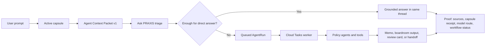

# PRAXIS Agentic Workflow Explained

PRAXIS turns a user's question into a governed research or drafting run. The key idea is simple: the agent does not start from a blank chat prompt. It first reads the user's active capsule, converts the useful parts into a compact Agent Context Packet, decides whether the question needs a quick answer or durable agent work, then returns an answer with proof.

## What Happens

1. A user asks a question and may attach a capsule.
2. PRAXIS reads the capsule's User, Situation, Tool, Output, source, document, graph, time, and memory references.
3. PRAXIS serializes the most relevant context into Agent Context Packet v1. This packet tells the model what facts, claims, source receipts, graph neighborhoods, gaps, and review rules it may use.
4. Ask PRAXIS triages the request: simple answer, research memo, source-gap review, boardroom discussion, output formatting, or handoff.
5. If the answer can be handled in the current turn, PRAXIS answers in the same thread with receipts.
6. If the work is deeper, PRAXIS creates a durable AgentRun, queues it through Cloud Tasks, and lets the worker run the right policy agent path.
7. The result comes back with proof: what context was read, which tools or sources were used, what was queued, what artifact was saved, and what still needs review.

## Why Capsules Make It Smarter

A generic chatbot sees the latest prompt. PRAXIS sees the working file around the prompt.

The capsule gives the agent:
- who the user is and what tone or audience they need,
- what situation is being analyzed,
- which sources and documents are approved or stale,
- which tools or thinking methods should be used,
- what output shape is expected,
- what claims are unsupported, disputed, advisory, or ready.

The Agent Context Packet makes that context usable by the model. It compresses the capsule into a structured read order, source map, ontology contract, salience ledger, incident neighborhoods, reasoning paths, and explicit rules for what the agent may and may not assume.

## Why It Is More Trustworthy

PRAXIS separates context, reasoning, tools, and proof.

The agent is told when a fact comes from the capsule, when a source is stale, when a graph row is advisory, and when evidence is missing. For deeper work, the run is saved as an AgentRun instead of disappearing inside one chat response. That gives the user a trail: capsule read receipt, workflow plan, selected tools, source receipts, queued worker status, output artifact, and next review step.

In plain English: PRAXIS is not just "ask an AI." It is "ask an AI inside a governed policy workbench, with the user's saved context, source rules, task plan, and proof trail attached."

## Policy-Agent Roster

The roster source of truth is `src/lib/product/policy-agents.ts`. Each entry declares its capability, input/output contract, recommended tool route, output destination, and `modelTaskKind`. The task kind points to `src/lib/ai/MODEL_MATRIX.json`; agent code must not hardcode provider model ids.

| Agent | Capability | When It Runs | Model Task Kind | Output Destination | Proof Returned |
|---|---|---|---|---|---|
| Capsule AI | Builds or improves ContextCapsule cores | Capsule build/improvement or governance prompts | `complex_reasoning` | Library | Capsule read receipt, review-card-only workflow plan, suggested tool/source gaps |
| Writer / Drafter | Produces memos, briefs, and sections in the capsule output format | Research memo, brief, options paper, or drafting requests | `writing_quality` | Work | Memo draft, sourceability ledger, source receipts, output capsule link when saved |
| Sourceability Reviewer | Source-checks citations, relevance, freshness, credibility, and unsupported claims | Sourceability, citation audit, deep/current research, handover, or export-sensitive work | `complex_reasoning` | Work | Claim ledger, source receipt ids, weak/unsupported/stale findings, review blockers |
| Difference Checker | Compares positions, claims, sources, or capsule versions | Compare/delta/conflict/contradiction prompts | `complex_reasoning` | Work | Delta report, aligned points, contradictions, source conflicts, review blockers |
| Media Summarizer | Summarizes documents, transcripts, and media-derived text into cited claims | Transcript, document, recording, or source-cited summary requests | `long_context` | Library | Source-cited claim summary, attribution notes, uncertainty and corroboration gaps |
| Human-Friction Analyst | Applies the ACO lens to conflict dynamics | ACO, spoiler, leverage, commitment, narrative, escalation-risk, or conflict-dynamics prompts | `complex_reasoning` | Canvas | Actor/Claim/Interest/Constraint/Leverage/Commitment/Event/Narrative findings with caveats |
| Red-Team Analyst | Challenges assumptions, options, incentives, and evidence quality | Red-team, stress-test, or multi-agent review requests | `complex_reasoning` | Work | Adversarial findings, assumption pressure, revision requirements |
| Handover Builder | Packages context for another analyst or agent | Handover, successor, or continuity requests | `writing_quality` | Handover | Handover package with capsule state, gaps, receipts, next actions, and run pointers |
| Source-Gap Scout | Finds candidate sources for unsupported claims | Source-gap and gap-fill flows | `balanced` | Library | Review-gated source-pack cards and candidate source receipts |
| Capsule Quality Review | Files capsule improvement proposals | Capsule readiness or quality review flows | `balanced` | Library | Review cards for source, claim, graph, instruction, and operability improvements |
| Boardroom Discussion | Runs chair-led multi-lens deliberation | Boardroom or participant-lens requests | `complex_reasoning` | Library | Transcript proof, chair synthesis, evidence stats, risks, open questions |
| Output Formatter | Formats an answer or memo into an export-ready product | Format, DOCX, PDF, Markdown, report, or export-ready requests | `writing_quality` | Work | Structured work product plus sourceability and handover notes |
| Daily Brief Agent | Produces recurring capsule-delta briefs | Daily brief/watchlist flows | `writing_quality` | Work | Dated brief draft, fresh receipts, capsule deltas, unresolved gaps |
| Conflict Monitor | Tracks actor, event, commitment, and source changes | Planned monitoring flows | `balanced` | Canvas | Change digest and review-gated monitoring notes |

## How Triage Selects the Team

Ask PRAXIS first honors an explicitly selected roster agent. If none is selected, `src/lib/ai/tacitus-routing-policy.ts` maps the prompt and intent to a policy-agent id. Examples:

- Drafting, memo, brief, or options-paper requests route to Writer / Drafter.
- Sourceability, citation audit, verification, or unsupported-claim prompts route to Sourceability Reviewer.
- Compare, delta, contradiction, versus, and conflict prompts route to Difference Checker.
- Transcript, media, recording, and source-cited summary prompts route to Media Summarizer.
- ACO, spoiler, leverage, commitment, narrative, escalation-risk, and conflict-dynamics prompts route to Human-Friction Analyst.

`src/lib/agent-runtime/workflow-plan.ts` then classifies the run into the existing workflow kinds: direct answer, current research brief, PDF/memo output, gap fill, multi-agent review, handover, or capsule governance. The workflow plan adds visible steps for selected roster agents and keeps the source-check lane explicit when sourceability is required.

## How Outputs Return With Proof

Queued work still uses the existing AgentRun and Cloud Tasks worker path. The worker reads the Agent Context Packet and capsule receipt, emits workflow proof events, runs the selected registered tools, and saves reviewable outputs to the declared destination. User-visible proof includes:

- capsule read receipt and selected core refs,
- workflow plan and team steps,
- selected roster agent and model task kind,
- selected tool ids and approval-gated tool ids,
- sourceability ledger and source receipt ids,
- worker events, output link, and next review step.
