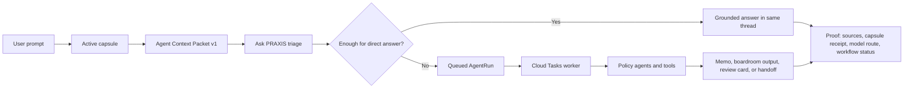

# PRAXIS Agentic Workflow Explained

PRAXIS turns a user's question into a governed research or drafting run. The key idea is simple: the agent does not start from a blank chat prompt. It first reads the user's active capsule, converts the useful parts into a compact Agent Context Packet, decides whether the question needs a quick answer or durable agent work, then returns an answer with proof.

## What Happens

1. A user asks a question and may attach a capsule.
2. PRAXIS reads the capsule's User, Situation, Tool, Output, source, document, graph, time, and memory references.
3. PRAXIS serializes the most relevant context into Agent Context Packet v1. This packet tells the model what facts, claims, source receipts, graph neighborhoods, gaps, and review rules it may use.
4. Ask PRAXIS triages the request: simple answer, research memo, source-gap review, boardroom discussion, output formatting, or handoff.
5. If the answer can be handled in the current turn, PRAXIS answers in the same thread with receipts.
6. If the work is deeper, PRAXIS creates a durable AgentRun, queues it through Cloud Tasks, and lets the worker run the right policy agent path.
7. The result comes back with proof: what context was read, which tools or sources were used, what was queued, what artifact was saved, and what still needs review.

## Why Capsules Make It Smarter

A generic chatbot sees the latest prompt. PRAXIS sees the working file around the prompt.

The capsule gives the agent:
- who the user is and what tone or audience they need,
- what situation is being analyzed,
- which sources and documents are approved or stale,
- which tools or thinking methods should be used,
- what output shape is expected,
- what claims are unsupported, disputed, advisory, or ready.

The Agent Context Packet makes that context usable by the model. It compresses the capsule into a structured read order, source map, ontology contract, salience ledger, incident neighborhoods, reasoning paths, and explicit rules for what the agent may and may not assume.

## Why It Is More Trustworthy

PRAXIS separates context, reasoning, tools, and proof.

The agent is told when a fact comes from the capsule, when a source is stale, when a graph row is advisory, and when evidence is missing. For deeper work, the run is saved as an AgentRun instead of disappearing inside one chat response. That gives the user a trail: capsule read receipt, workflow plan, selected tools, source receipts, queued worker status, output artifact, and next review step.

In plain English: PRAXIS is not just "ask an AI." It is "ask an AI inside a governed policy workbench, with the user's saved context, source rules, task plan, and proof trail attached."

